# Technical Design: Colombian & Venezuelan Plate Masks + Impeccable Live Operations Mockup

## Architecture Overview

This feature delivers two synchronized technical assets:
1. **Production Angular Directive (`PlateMaskDirective`)**: A high-performance, standalone UI directive that enforces country- and vehicle-specific license plate masks in real time on any `<input>` element with zero external library overhead.
2. **Interactive Live Operations Mockup (`mockup.html`)**: An Impeccable-grade, zero-dependency HTML5/Tailwind/Vanilla JS simulation of the complete operational parking lifecycle for operator speed trials and stakeholder validation.

```mermaid
flowchart TD
    subgraph UI["CheckInModalComponent (Angular 19+)"]
        InputElem["<input #plateInput [appPlateMask] [country]='facade.plateCountry()' [vehicleType]='facade.vehicleType()'>"]
        CountrySelector["Country Selector ('CO' | 'VE' | 'UNPLATED')"]
        VehicleSelector["Vehicle Type ('CAR' | 'MOTORCYCLE' | 'BIKE')"]
    end

    subgraph Directive["PlateMaskDirective (apps/web/src/app/shared/directives/plate-mask.ts)"]
        Sanitizer["Alpha-numeric Sanitizer & Uppercaser"]
        CaretEngine["Caret Tracker & Backspace Resolver"]
        Formatter["Format Dispatcher (CO Car, CO Moto, VE Vehicle)"]
    end

    subgraph State["CheckInFacade & Services"]
        FacadeState["CheckInFacade.plate (Signal)"]
        ValidationRule["VE_PLATE_REGEX & CO Rule Validation"]
        SubmitAction["submitCheckIn() -> TicketService"]
    end

    CountrySelector -->|country input| Directive
    VehicleSelector -->|vehicleType input| Directive
    InputElem -->|Keystroke Event| Sanitizer
    Sanitizer --> CaretEngine
    CaretEngine --> Formatter
    Formatter -->|Set DOM value & Dispatch input event| InputElem
    InputElem -->|onPlateInput event| FacadeState
    FacadeState --> ValidationRule
    ValidationRule --> SubmitAction
```



---

## 1. `PlateMaskDirective` Specification

- **File Path**: `apps/web/src/app/shared/directives/plate-mask.ts`
- **Unit Test Path**: `apps/web/src/app/shared/directives/plate-mask.spec.ts`
- **Selector**: `[appPlateMask]`
- **Standalone**: `true`

### 1.1 Inputs & Outputs
```typescript
@Directive({
  selector: 'input[appPlateMask]',
  standalone: true,
})
export class PlateMaskDirective {
  /** Target registration country: 'CO' | 'VE' | 'UNPLATED' */
  readonly country = input<PlateCountry>('CO');

  /** Vehicle type for specialized sub-masks (e.g. Colombian motorcycles): 'CAR' | 'MOTORCYCLE' | 'BIKE' */
  readonly vehicleType = input<VehicleType>('CAR');

  /** Optional output emitting raw alphanumeric string (e.g., 'ABC123') */
  readonly rawPlateChange = output<string>();
}
```

### 1.2 Formatting Matrix & Domain Rules

| Country | Vehicle Type | Raw Length | Raw Pattern | Formatted Format | Example Input | Formatted Output |
| :--- | :--- | :---: | :--- | :--- | :--- | :--- |
| **Colombia (`CO`)** | `CAR` | 6 chars | 3 Letters + 3 Digits | `AAA-000` | `abc123` | `ABC-123` |
| **Colombia (`CO`)** | `MOTORCYCLE` | 6 chars | 3 Letters + 2 Digits + 1 Letter | `AAA-00A` | `abc12d` | `ABC-12D` |
| **Venezuela (`VE`)** | Any | 7 chars | 2 Letters + 3 Digits + 2 Letters | `AA-000-AA` | `ab123cd` | `AB-123-CD` |
| **Unplated (`UNPLATED`)** | Any | N/A | Mask disabled | Raw input | N/A | Unaltered |

#### Progressive Formatting States

1. **Colombia (Automobile `AAA-000`)**:
   - `len <= 3`: Characters 0..2 are forced letters: `A`, `AB`, `ABC`.
   - `len > 3`: Characters 3..5 are forced digits. Format: `ABC-` then `ABC-1`, `ABC-12`, `ABC-123`.

2. **Colombia (Motorcycle `AAA-00A`)**:
   - `len <= 3`: Characters 0..2 are forced letters: `A`, `AB`, `ABC`.
   - `len 4..5`: Characters 3..4 are forced digits: `ABC-1`, `ABC-12`.
   - `len 6`: Character 5 is a forced letter: `ABC-12D`.

3. **Venezuela (`AA-000-AA`)**:
   - `len <= 2`: Characters 0..1 are forced letters: `A`, `AB`.
   - `2 < len <= 5`: Characters 2..4 are forced digits: `AB-1`, `AB-12`, `AB-123`.
   - `len > 5`: Characters 5..6 are forced letters: `AB-123-C`, `AB-123-CD`.

### 1.3 Caret Positioning & Backspace Stability

A common defect in masking directives is cursor instability (cursor jumps to the end of the input whenever a separator `-` is inserted, or backspace on a delimiter does not delete the character preceding it).

#### Caret Preservation Algorithm:
1. Before formatting, record the current caret position `selectionStart` and count how many **raw alphanumeric characters** precede the cursor (`rawCharsBeforeCursor`).
2. If the user pressed `Backspace` directly after a delimiter `-`, decrement `rawCharsBeforeCursor` by 1 to delete the preceding alphanumeric character cleanly.
3. Compute the newly masked string from the sanitized alphanumeric content.
4. Scan the masked string to find the index where the count of alphanumeric characters equals `rawCharsBeforeCursor`.
5. Update the DOM `input.value` and apply `input.setSelectionRange(targetIndex, targetIndex)` synchronously.

### 1.4 Input Sanitization & Uppercasing
- Non-alphanumeric characters (spaces, periods, slashes, unexpected symbols) are stripped on entry.
- All letters are converted to uppercase via `toUpperCase()` before validation and mask mapping.
- Native `input` event is dispatched (`dispatchEvent(new Event('input'))`) so that Angular `ControlValueAccessor` and parent `(input)` listeners receive immediate updates.

---

## 2. Integration with `CheckInModalComponent` & `CheckInFacade`

### 2.1 Component Template Updates (`check-in-modal.html`)
The existing `#plateInput` in `check-in-modal.html` will be enhanced with `appPlateMask`:
```html
<input
  id="plate-input"
  #plateInput
  type="text"
  appPlateMask
  [country]="facade.plateCountry()"
  [vehicleType]="facade.vehicleType()"
  [value]="facade.plate()"
  (input)="onPlateInput($event)"
  (keydown.enter)="onEnterKey($event)"
  [placeholder]="facade.plateCountry() === 'VE' ? texts.platePlaceholderVe : texts.platePlaceholderCo"
  autocomplete="off"
  class="border-input bg-background text-foreground placeholder:text-muted-foreground focus:border-ring w-full rounded-xl border px-4 py-3 font-mono text-base font-bold tracking-widest uppercase transition-all placeholder:font-normal placeholder:tracking-normal focus:outline-hidden sm:text-lg"
/>
```

### 2.2 Component Class Updates (`check-in-modal.ts`)
- Import `PlateMaskDirective` in `imports: [..., PlateMaskDirective]`.
- Reactivity: When `onPlateCountrySelect(country)` or vehicle type changes, `PlateMaskDirective` automatically re-evaluates the existing input value to conform to the new mask.

### 2.3 Facade Compatibility (`CheckInFacade`)
The `CheckInFacade.isValid` computed signal already cleans delimiters (`this.plate().replace(/[\s-]/g, "").toUpperCase()`) for regex testing:
- Venezuelan regex: `^([A-Z]{2}\d{3}[A-Z]{2}|...)$` will match the unmasked 7-char string `AB123CD`.
- Colombian check: `cleaned.length >= 3` will match `ABC123` or `ABC12D`.
- Payload submission: `plate` property sends the properly formatted or clean plate string to `CreateTicketPayload`.

---

## 3. High-Fidelity Interactive Mockup (`mockup.html`)

An Impeccable interactive prototype located at `openspec/changes/2026-10-16-plate-masks-and-live-ops/mockup.html`.

### 3.1 Design Principles & Aesthetics
- **Zero-Dependency Architecture**: Uses Tailwind CSS via CDN, Lucide icons via SVG definitions, and pure native JavaScript. Can be opened immediately in any browser via `file://` or local dev server.
- **Nivo Brand Conformity**: Dark/Light mode theme palette, JetBrains Mono font for license plates and tickets, responsive mobile/tablet/desktop layouts.
- **Micro-Interactions**: Real-time mask formatting, animated transitions, toast notifications, live entry timer ticker.

### 3.2 Implemented Prototype Views

1. **Live Operations Dashboard**:
   - Header with tenant & parking lot switcher, active operational shift, and live clock.
   - Quick KPI cards: Total Slots, Occupied Slots, Real-Time Occupancy Rate (with gauge), Revenue of the Day, Average Stay Duration.
   - Live Vehicle Grid / Active Ticket Table: searchable by plate or slot, filterable by vehicle category (`CAR`, `MOTO`, `BIKE`), status indicators.
   - Floating Action Bar: "Nuevo Ingreso (F1)", "Registrar Salida (F2)", "Escanear QR".

2. **Check-in Modal with Live Plate Masking**:
   - Dynamic Country Selector (`Colombia` with Flag, `Venezuela` with Flag, `Sin Placa / Incógnito`).
   - Vehicle Type Selector with instant rate preview (Automóvil $4.500/hr, Moto $2.500/hr, Bici $1.000/hr).
   - Interactive License Plate Input:
     - Real-time keystroke masking matching `PlateMaskDirective` behavior.
     - Live visual validation badge (e.g., "Placa Colombiana Válida", "Formato Venezolano Correcto").
   - Optional Phone & Digital Receipt toggle (WhatsApp / SMS dispatch).
   - "Emitir Ticket e Ingresar" button with loading micro-animation and keyboard shortcut (`Enter`).

3. **Check-out & Zero-Payment Settlement Drawer**:
   - Search by plate number or ticket barcode.
   - Real-time stay duration breakdown (e.g. 1h 42m) with grace-period logic (under 15 min = Free Departure).
   - Detailed price breakdown: subtotal, VAT 19%, total to pay.
   - Payment method selection: Cash, Wompi QR, Zero-Cost Grace Period.
   - "Autorizar Salida y Liberar Cupo" instant action.

4. **Digital Thermal QR Receipt**:
   - Realistic 80mm thermal receipt card preview.
   - Barcode + dynamic SVG QR code rendering containing ticket verification URL.
   - Action buttons: "Imprimir Comprobante (POS)", "Enviar por WhatsApp", "Copiar Enlace Digital".

---

## 4. Verification & Testing Strategy

1. **Unit Tests (`plate-mask.spec.ts`)**:
   - Test Colombian car mask (`abc123` -> `ABC-123`).
   - Test Colombian moto mask (`abc12d` -> `ABC-12D`).
   - Test Venezuelan mask (`ab123cd` -> `AB-123-CD`).
   - Test caret positioning during mid-string edits.
   - Test backspace behavior across hyphen boundaries.
   - Test unplated / bypass mode.
2. **Integration Tests (`check-in-modal.spec.ts`)**:
   - Verify modal inputs correctly delegate to the directive.
   - Verify country switch reformats or resets existing value.
   - Verify facade `isValid` updates reactively upon valid masked input.
3. **Regression Test Run**:
   - Execute full test suite `ng test --watch=false` to verify zero regressions across existing operations tests.
