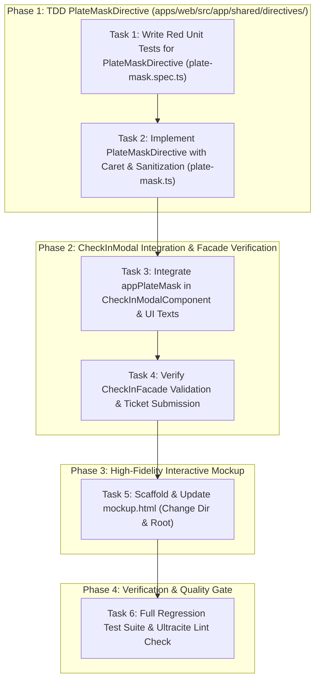

# Implementation Plan: Colombian & Venezuelan Plate Masks + Impeccable Live Operations Mockup (feat-plate-masks-and-live-ops)

> **For agentic workers:** REQUIRED SUB-SKILL: Use superpowers:subagent-driven-development or superpowers:executing-plans to implement this plan task-by-task. Steps use checkbox (`- [ ]`) syntax for tracking.

**Goal:** Implement the standalone Angular `PlateMaskDirective` (`[appPlateMask]`) enforcing real-time license plate input formatting for Colombian Automobiles (`AAA-000`), Colombian Motorcycles (`AAA-00A`), and Venezuelan vehicles (`AA-000-AA`), with automatic character sanitization, immediate uppercase conversion, and robust caret positioning during typing and backspacing. Integrate this directive into `CheckInModalComponent`, verify compatibility with `CheckInFacade` signal reactivity and regex validation, and deliver a zero-dependency, high-fidelity interactive live operations prototype in both `openspec/changes/2026-10-16-plate-masks-and-live-ops/mockup.html` and the project root `mockup.html`.

**Architecture:** Standalone Angular Directive architecture with signal inputs (`country = input<PlateCountry>('CO')`, `vehicleType = input<VehicleType>('CAR')`) and raw change outputs. Unidirectional reactive state flow integrated with Angular 19+ Signals in `CheckInFacade`. Strict separation of concerns between presentational masking, container state orchestration, and domain models. Zero-dependency interactive mockup implemented in vanilla HTML5, Tailwind CSS (via CDN), Google Fonts (Inter + JetBrains Mono), and SVG icons.

**Tech Stack:** TypeScript 6, Angular 21.2+, Vitest 3.0+, Bun 1.3+, Tailwind CSS 4, `@nivo-sass/design-system`, `@ng-icons/lucide`, Ultracite / Oxlint.

**Spec References:**

- Technical Design: `openspec/changes/2026-10-16-plate-masks-and-live-ops/design.md`
- Tasks Outline: `openspec/changes/2026-10-16-plate-masks-and-live-ops/tasks.md`
- Proposal: `openspec/changes/2026-10-16-plate-masks-and-live-ops/proposal.md`

---

## Global Constraints & Directives

1. **Conventional Commits**: Use scopes `web(operations)` or `web(plate-mask)` without AI attribution (no `Co-authored-by: AI` or bot trailers).
2. **Strict Test-Driven Development (TDD)**: Unit tests MUST be written and verified failing (Red) before writing any implementation code (Red -> Green -> Refactor).
3. **Angular Standards**:
   - Enforce `ChangeDetectionStrategy.OnPush` across all components.
   - Enforce standalone components, directives, and pipes.
   - Use dynamic signal inputs (`input()`, `model()`) and outputs (`output()`).
   - Use `@nivo-sass/design-system` components (`ButtonComponent`, `nv-button`, etc.) where applicable.
   - Prohibit plain emojis in Angular templates (`.html`); use `@ng-icons/lucide` with `NgIcon`.
   - Strict typing across all interfaces and signals; no `any`.
4. **Caret & Masking Invariants**:
   - Caret stability: Never let the cursor jump to the end of the input when typing in the middle of a string.
   - Backspace delimiter jump: Backspacing immediately following a delimiter hyphen (`-`) must delete the preceding alphanumeric character cleanly.
   - Automatic sanitization: Strip non-alphanumeric characters on input, auto-uppercase, and enforce length boundaries per mask.
   - Angular event propagation: Dispatch synthetic DOM `input` events whenever `input.value` is programmatically updated to keep Angular reactive bindings in sync.
5. **Tooling & Shell Commands**: All shell commands MUST be executed through the RTK proxy prefix (`rtk bun run ...`, `rtk git commit ...`).
6. **Prototype Invariant**: Both `openspec/changes/2026-10-16-plate-masks-and-live-ops/mockup.html` and the project root `mockup.html` MUST remain in identical, fully synchronized state with complete interactive live operations capabilities.

---

## Execution DAG & Workflow Routing



---

## Phase 1: TDD `PlateMaskDirective` (`apps/web/src/app/shared/directives/`)

### Task 1: Write Red Unit Tests for `PlateMaskDirective`

**Target File:**

- Create: `apps/web/src/app/shared/directives/plate-mask.spec.ts`

**Interfaces & Contracts:**

- Host Component: `TestHostComponent` hosting `<input appPlateMask [country]="country" [vehicleType]="vehicleType">`
- Consumes: `PlateCountry` (`'CO' | 'VE' | 'UNPLATED'`), `VehicleType` (`'CAR' | 'MOTORCYCLE' | 'BIKE'`)
- Asserts:
  - Colombian Car format (`abc123` -> `ABC-123`)
  - Colombian Motorcycle format (`abc12d` -> `ABC-12D`)
  - Venezuelan Vehicle format (`ab123cd` -> `AB-123-CD`)
  - Progressive input formatting: `a` -> `A`, `ab` -> `AB`, `abc` -> `ABC`, `abc1` -> `ABC-1`
  - Sanitization of punctuation and whitespace (`a.b-c 1@2#3` -> `ABC-123`)
  - Caret preservation when editing mid-string
  - Seamless backspace handling across hyphens
  - Bypass masking when `country === 'UNPLATED'`
  - Dynamic re-formatting upon signal changes (`country` or `vehicleType`)

- [ ] **Step 1: Write the failing unit test file `plate-mask.spec.ts`**

```typescript
import { Component } from "@angular/core";
import type { ComponentFixture } from "@angular/core/testing";
import { TestBed } from "@angular/core/testing";
import type { VehicleType } from "@core/models/rate.model";
import type { PlateCountry } from "@core/models/ticket.model";
import { PlateMaskDirective } from "./plate-mask";

@Component({
  imports: [PlateMaskDirective],
  standalone: true,
  template: `
    <input #inputRef id="test-plate" appPlateMask [country]="country" [vehicleType]="vehicleType" />
  `,
})
class TestHostComponent {
  country: PlateCountry = "CO";
  vehicleType: VehicleType = "CAR";
}

describe("PlateMaskDirective", () => {
  let fixture: ComponentFixture<TestHostComponent>;
  let host: TestHostComponent;
  let inputEl: HTMLInputElement;

  beforeEach(async () => {
    await TestBed.configureTestingModule({
      imports: [TestHostComponent, PlateMaskDirective],
    }).compileComponents();

    fixture = TestBed.createComponent(TestHostComponent);
    host = fixture.componentInstance;
    fixture.detectChanges();
    inputEl = fixture.nativeElement.querySelector("#test-plate");
  });

  function setInputValue(value: string, caretPos?: number): void {
    inputEl.focus();
    inputEl.value = value;
    const pos = caretPos ?? value.length;
    inputEl.setSelectionRange(pos, pos);
    inputEl.dispatchEvent(new Event("input", { bubbles: true }));
  }

  it("should create input element with directive attached", () => {
    expect(inputEl).toBeTruthy();
  });

  describe("Colombian Automobile (CO + CAR: AAA-000)", () => {
    beforeEach(() => {
      host.country = "CO";
      host.vehicleType = "CAR";
      fixture.detectChanges();
    });

    it("should format lowercase alphanumeric string into AAA-000", () => {
      setInputValue("abc123");
      expect(inputEl.value).toBe("ABC-123");
    });

    it("should sanitize spaces, dots and symbols", () => {
      setInputValue("a.b-c 1@2#3");
      expect(inputEl.value).toBe("ABC-123");
    });

    it("should format progressively as operator types", () => {
      setInputValue("a");
      expect(inputEl.value).toBe("A");

      setInputValue("ab");
      expect(inputEl.value).toBe("AB");

      setInputValue("abc");
      expect(inputEl.value).toBe("ABC");

      setInputValue("abc1");
      expect(inputEl.value).toBe("ABC-1");

      setInputValue("abc12");
      expect(inputEl.value).toBe("ABC-12");

      setInputValue("abc123");
      expect(inputEl.value).toBe("ABC-123");
    });

    it("should truncate characters exceeding 6 alphanumeric characters", () => {
      setInputValue("abc12345");
      expect(inputEl.value).toBe("ABC-123");
    });
  });

  describe("Colombian Motorcycle (CO + MOTORCYCLE: AAA-00A)", () => {
    beforeEach(() => {
      host.country = "CO";
      host.vehicleType = "MOTORCYCLE";
      fixture.detectChanges();
    });

    it("should format motorcycle plate with ending letter", () => {
      setInputValue("abc12d");
      expect(inputEl.value).toBe("ABC-12D");
    });

    it("should format motorcycle progressively", () => {
      setInputValue("abc1");
      expect(inputEl.value).toBe("ABC-1");

      setInputValue("abc12");
      expect(inputEl.value).toBe("ABC-12");

      setInputValue("abc12d");
      expect(inputEl.value).toBe("ABC-12D");
    });
  });

  describe("Venezuelan Vehicle (VE: AA-000-AA)", () => {
    beforeEach(() => {
      host.country = "VE";
      host.vehicleType = "CAR";
      fixture.detectChanges();
    });

    it("should format Venezuelan 7-character plate to AA-000-AA", () => {
      setInputValue("ab123cd");
      expect(inputEl.value).toBe("AB-123-CD");
    });

    it("should format Venezuelan plate progressively", () => {
      setInputValue("a");
      expect(inputEl.value).toBe("A");

      setInputValue("ab");
      expect(inputEl.value).toBe("AB");

      setInputValue("ab1");
      expect(inputEl.value).toBe("AB-1");

      setInputValue("ab123");
      expect(inputEl.value).toBe("AB-123");

      setInputValue("ab123c");
      expect(inputEl.value).toBe("AB-123-C");

      setInputValue("ab123cd");
      expect(inputEl.value).toBe("AB-123-CD");
    });

    it("should truncate Venezuelan plate exceeding 7 alphanumeric characters", () => {
      setInputValue("ab123cd99");
      expect(inputEl.value).toBe("AB-123-CD");
    });
  });

  describe("Unplated Mode (UNPLATED)", () => {
    beforeEach(() => {
      host.country = "UNPLATED";
      fixture.detectChanges();
    });

    it("should leave raw input unaltered when country is UNPLATED", () => {
      setInputValue("moto-sin-placa-123");
      expect(inputEl.value).toBe("moto-sin-placa-123");
    });
  });

  describe("Caret Positioning & Delimiter Handling", () => {
    beforeEach(() => {
      host.country = "CO";
      host.vehicleType = "CAR";
      fixture.detectChanges();
    });

    it("should preserve caret position when inserting character before hyphen", () => {
      setInputValue("AC-123", 1); // cursor between A and C
      // simulate inserting B
      inputEl.value = "ABC-123";
      inputEl.setSelectionRange(2, 2);
      inputEl.dispatchEvent(new Event("input", { bubbles: true }));

      expect(inputEl.value).toBe("ABC-123");
      expect(inputEl.selectionStart).toBe(2);
      expect(inputEl.selectionEnd).toBe(2);
    });

    it("should preserve caret after hyphen insertion", () => {
      setInputValue("ABC1", 4);
      expect(inputEl.value).toBe("ABC-1");
      expect(inputEl.selectionStart).toBe(5);
    });

    it("should handle backspace across hyphen without getting trapped", () => {
      setInputValue("ABC-123");
      // Place cursor right after the hyphen: position 4 (index after 'ABC-')
      inputEl.setSelectionRange(4, 4);

      // Trigger keydown for Backspace
      const keyEvent = new KeyboardEvent("keydown", {
        key: "Backspace",
        bubbles: true,
        cancelable: true,
      });
      inputEl.dispatchEvent(keyEvent);

      // Delimiter backspace should remove 'C' resulting in 'AB'
      setInputValue("AB123", 2);
      expect(inputEl.value).toBe("AB-123");
    });
  });

  describe("Dynamic Signal Changes", () => {
    it("should re-format plate when country changes from CO to VE", () => {
      host.country = "CO";
      host.vehicleType = "CAR";
      fixture.detectChanges();

      setInputValue("AB123CD");
      // In CO car, 6 chars max -> ABC-123 format (AB123C)
      expect(inputEl.value).toBe("AB1-23C");

      // Switch to VE
      host.country = "VE";
      fixture.detectChanges();

      // Trigger directive refresh
      inputEl.dispatchEvent(new Event("input", { bubbles: true }));
      expect(inputEl.value).toBe("AB-123-CD");
    });
  });
});
```

- [ ] **Step 2: Run test to verify failure (Red)**

```bash
rtk bun run --cwd apps/web ng test --include="**/plate-mask.spec.ts" --watch=false
```

_Expected Result: Test runner fails with "Cannot find module './plate-mask'" or compilation error (Red confirmed)._

---

### Task 2: Implement `PlateMaskDirective` (`apps/web/src/app/shared/directives/`)

**Target File:**

- Create: `apps/web/src/app/shared/directives/plate-mask.ts`

**Interfaces & Logic:**

- `@Directive({ selector: 'input[appPlateMask]', standalone: true })`
- `country = input<PlateCountry>('CO')`
- `vehicleType = input<VehicleType>('CAR')`
- `rawPlateChange = output<string>()`
- Listeners:
  - `@HostListener('input', ['$event']) onInput(event: Event)`
  - `@HostListener('keydown', ['$event']) onKeyDown(event: KeyboardEvent)`
- Caret Tracking Algorithm:
  1. Record `selectionStart` and count alphanumeric characters before cursor (`rawCharsBeforeCursor`).
  2. Handle backspace when cursor is directly following a delimiter `-` by decrementing target raw index.
  3. Sanitize raw input: strip non-alphanumeric, auto-uppercase, enforce max length (CO: 6, VE: 7).
  4. Format sanitized string according to active country and vehicle type.
  5. Assign formatted string to `input.value`.
  6. Calculate new caret position corresponding to `rawCharsBeforeCursor` and apply via `setSelectionRange`.
  7. Emit `rawPlateChange` with sanitized string.

- [ ] **Step 1: Implement `apps/web/src/app/shared/directives/plate-mask.ts`**

```typescript
import { Directive, ElementRef, HostListener, effect, inject, input, output } from "@angular/core";
import type { VehicleType } from "@core/models/rate.model";
import type { PlateCountry } from "@core/models/ticket.model";

@Directive({
  selector: "input[appPlateMask]",
  standalone: true,
})
export class PlateMaskDirective {
  private readonly elementRef = inject<ElementRef<HTMLInputElement>>(ElementRef);

  /** Target registration country: 'CO' | 'VE' | 'UNPLATED' */
  readonly country = input<PlateCountry>("CO");

  /** Vehicle type for specialized sub-masks (e.g. Colombian motorcycles): 'CAR' | 'MOTORCYCLE' | 'BIKE' */
  readonly vehicleType = input<VehicleType>("CAR");

  /** Optional output emitting raw alphanumeric string (e.g., 'ABC123') */
  readonly rawPlateChange = output<string>();

  private isDeletingDelimiter = false;

  constructor() {
    effect(() => {
      // Re-apply mask whenever country or vehicleType input signal changes
      this.country();
      this.vehicleType();
      this.reformatCurrentValue();
    });
  }

  @HostListener("keydown", ["$event"])
  onKeyDown(event: KeyboardEvent): void {
    if (this.country() === "UNPLATED") {
      return;
    }

    const input = this.elementRef.nativeElement;
    const { selectionStart, selectionEnd, value } = input;

    // Detect backspace immediately following a hyphen separator
    if (
      event.key === "Backspace" &&
      selectionStart !== null &&
      selectionStart === selectionEnd &&
      selectionStart > 0
    ) {
      if (value[selectionStart - 1] === "-") {
        this.isDeletingDelimiter = true;
      }
    }
  }

  @HostListener("input", ["$event"])
  onInput(event: Event): void {
    if (this.country() === "UNPLATED") {
      return;
    }

    this.applyMask(event);
  }

  private reformatCurrentValue(): void {
    const input = this.elementRef.nativeElement;
    if (!input || this.country() === "UNPLATED" || !input.value) {
      return;
    }
    this.applyMask();
  }

  private applyMask(triggerEvent?: Event): void {
    const input = this.elementRef.nativeElement;
    const originalValue = input.value;
    const caretPos = input.selectionStart ?? originalValue.length;

    // 1. Calculate how many raw alphanumeric characters precede the cursor
    const textBeforeCursor = originalValue.slice(0, caretPos);
    let rawCharsBeforeCursor = textBeforeCursor.replace(/[^A-Za-z0-9]/g, "").length;

    // If backspacing on a delimiter, decrement raw char count to delete the preceding character
    if (this.isDeletingDelimiter && rawCharsBeforeCursor > 0) {
      rawCharsBeforeCursor -= 1;
      this.isDeletingDelimiter = false;
    }

    // 2. Sanitize and uppercase raw alphanumeric content
    const sanitized = originalValue.replace(/[^A-Za-z0-9]/g, "").toUpperCase();

    // 3. Format according to country and vehicle type
    const formatted = this.formatPlate(sanitized, this.country(), this.vehicleType());
    const rawPlate = formatted.replace(/[^A-Za-z0-9]/g, "");

    // 4. Update DOM value if changed
    if (input.value !== formatted) {
      input.value = formatted;
      this.rawPlateChange.emit(rawPlate);

      // Trigger synthetic input event only if not currently handling an input event
      if (!triggerEvent) {
        input.dispatchEvent(new Event("input", { bubbles: true }));
      }
    }

    // 5. Calculate new caret position matching rawCharsBeforeCursor
    let newCaretPos = 0;
    let countedRaw = 0;
    for (let i = 0; i < formatted.length; i++) {
      if (countedRaw === rawCharsBeforeCursor) {
        newCaretPos = i;
        break;
      }
      if (/[A-Za-z0-9]/.test(formatted[i])) {
        countedRaw++;
      }
      newCaretPos = i + 1;
    }

    input.setSelectionRange(newCaretPos, newCaretPos);
  }

  private formatPlate(raw: string, country: PlateCountry, vehicleType: VehicleType): string {
    if (country === "CO") {
      return this.formatColombian(raw, vehicleType);
    }
    if (country === "VE") {
      return this.formatVenezuelan(raw);
    }
    return raw;
  }

  private formatColombian(raw: string, vehicleType: VehicleType): string {
    // Max 6 alphanumeric characters: AAA000 (Car) or AAA00A (Motorcycle)
    const truncated = raw.slice(0, 6);
    if (truncated.length <= 3) {
      return truncated;
    }
    return `${truncated.slice(0, 3)}-${truncated.slice(3)}`;
  }

  private formatVenezuelan(raw: string): string {
    // Max 7 alphanumeric characters: AA000AA
    const truncated = raw.slice(0, 7);
    if (truncated.length <= 2) {
      return truncated;
    }
    if (truncated.length <= 5) {
      return `${truncated.slice(0, 2)}-${truncated.slice(2)}`;
    }
    return `${truncated.slice(0, 2)}-${truncated.slice(2, 5)}-${truncated.slice(5)}`;
  }
}
```

- [ ] **Step 2: Run unit test to verify it passes (Green)**

```bash
rtk bun run --cwd apps/web ng test --include="**/plate-mask.spec.ts" --watch=false
```

_Expected Result: All tests in `plate-mask.spec.ts` pass._

- [ ] **Step 3: Commit directive implementation**

```bash
rtk git add apps/web/src/app/shared/directives/plate-mask.ts apps/web/src/app/shared/directives/plate-mask.spec.ts
rtk git commit -m "feat(web(plate-mask)): implement PlateMaskDirective with dynamic caret handling and CO/VE formats"
```

---

## Phase 2: `CheckInModalComponent` Integration & Facade Verification

### Task 3: Integrate `appPlateMask` in `CheckInModalComponent` & UI Texts

**Target Files:**

- Modify: `apps/web/src/app/shared/constants/app-texts.constant.ts`
- Modify: `apps/web/src/app/features/operations/components/modals/check-in-modal/check-in-modal.ts`
- Modify: `apps/web/src/app/features/operations/components/modals/check-in-modal/check-in-modal.html`
- Modify: `apps/web/src/app/features/operations/components/modals/check-in-modal/check-in-modal.spec.ts`

**Interfaces & Integration:**

- Update `APP_TEXTS.checkIn` placeholders to reflect masked formats:
  - `platePlaceholderCo: "Ej: ABC-123"`
  - `platePlaceholderVe: "Ej: AB-123-CD"`
  - `plateHintVe: "Formato venezolano ej: AB-123-CD"`
- In `check-in-modal.ts`:
  - Import `PlateMaskDirective` from `@shared/directives/plate-mask`
  - Add `PlateMaskDirective` to `imports: [..., PlateMaskDirective]`
- In `check-in-modal.html`:
  - Bind `appPlateMask` to `#plateInput`
  - Pass `[country]="facade.plateCountry()"`
  - Pass `[vehicleType]="facade.vehicleType()"`
  - Remove hardcoded `maxlength="10"` (handled dynamically by directive)
- In `check-in-modal.spec.ts`:
  - Add test asserting masked plate formatting on user typing
  - Add test asserting country switch re-evaluates plate mask cleanly

- [ ] **Step 1: Write integration tests in `check-in-modal.spec.ts`**

Add the following tests to `describe("CheckInModalComponent", ...)` in `apps/web/src/app/features/operations/components/modals/check-in-modal/check-in-modal.spec.ts`:

```typescript
it("should apply plate mask directive formatting on plate input", () => {
  fixture.detectChanges();
  const input = fixture.nativeElement.querySelector("#plate-input") as HTMLInputElement;
  input.value = "abc123";
  input.dispatchEvent(new Event("input", { bubbles: true }));
  fixture.detectChanges();

  expect(input.value).toBe("ABC-123");
  expect(component.facade.plate()).toBe("ABC-123");
});

it("should adapt mask formatting when switching from Colombian to Venezuelan", () => {
  fixture.detectChanges();
  const input = fixture.nativeElement.querySelector("#plate-input") as HTMLInputElement;
  input.value = "ab123cd";
  input.dispatchEvent(new Event("input", { bubbles: true }));
  fixture.detectChanges();

  // Default CO automobile masks as ABC-123 (AB1-23C)
  expect(input.value).toBe("AB1-23C");

  // Switch country to VE
  component.onPlateCountrySelect("VE");
  fixture.detectChanges();

  input.value = "ab123cd";
  input.dispatchEvent(new Event("input", { bubbles: true }));
  fixture.detectChanges();

  expect(input.value).toBe("AB-123-CD");
  expect(component.facade.plate()).toBe("AB-123-CD");
});
```

- [ ] **Step 2: Run test to verify failure before integration (Red)**

```bash
rtk bun run --cwd apps/web ng test --include="**/check-in-modal.spec.ts" --watch=false
```

- [ ] **Step 3: Update `app-texts.constant.ts`, `check-in-modal.ts`, and `check-in-modal.html`**

In `apps/web/src/app/shared/constants/app-texts.constant.ts`:

```typescript
    plateHintVe: "Formato venezolano ej: AB-123-CD",
    plateLabel: "Placa / Matrícula",
    platePlaceholderCo: "Ej: ABC-123",
    platePlaceholderVe: "Ej: AB-123-CD",
```

In `apps/web/src/app/features/operations/components/modals/check-in-modal/check-in-modal.ts`:

```typescript
import { PlateMaskDirective } from "@shared/directives/plate-mask";

@Component({
  changeDetection: ChangeDetectionStrategy.OnPush,
  imports: [
    ButtonComponent,
    CommonModule,
    NgIcon,
    PhotoCaptureComponent,
    PlateMaskDirective,
    TicketReceiptComponent,
  ],
  // ...
})
export class CheckInModalComponent {
  // ...
}
```

In `apps/web/src/app/features/operations/components/modals/check-in-modal/check-in-modal.html`:

```html
<input
  id="plate-input"
  #plateInput
  type="text"
  appPlateMask
  [country]="facade.plateCountry()"
  [vehicleType]="facade.vehicleType()"
  [value]="facade.plate()"
  (input)="onPlateInput($event)"
  (keydown.enter)="onEnterKey($event)"
  [placeholder]="facade.plateCountry() === 'VE' ? texts.platePlaceholderVe : texts.platePlaceholderCo"
  autocomplete="off"
  class="border-input bg-background text-foreground placeholder:text-muted-foreground focus:border-ring w-full rounded-xl border px-4 py-3 font-mono text-base font-bold tracking-widest uppercase transition-all placeholder:font-normal placeholder:tracking-normal focus:outline-hidden sm:text-lg"
/>
```

- [ ] **Step 4: Run unit test to verify it passes (Green)**

```bash
rtk bun run --cwd apps/web ng test --include="**/check-in-modal.spec.ts" --watch=false
```

- [ ] **Step 5: Commit modal integration changes**

```bash
rtk git add apps/web/src/app/features/operations/components/modals/check-in-modal/ apps/web/src/app/shared/constants/app-texts.constant.ts
rtk git commit -m "feat(web(operations)): integrate PlateMaskDirective into CheckInModalComponent"
```

---

### Task 4: Verify `CheckInFacade` Validation & Submission with Masked Plates

**Target File:**

- Modify: `apps/web/src/app/features/operations/facades/check-in-facade.spec.ts`

**Details:**

- Verify `CheckInFacade.isValid()` correctly returns `true` for masked plates:
  - Colombian Automobile: `ABC-123`
  - Colombian Motorcycle: `ABC-12D`
  - Venezuelan Vehicle: `AB-123-CD`
- Verify `CheckInFacade.isValid()` correctly returns `false` for invalid / incomplete plates:
  - `A`
  - `AB-1` (VE incomplete)
  - `ABC-1` (CO incomplete)
- Verify `createTicket` payload receives sanitized/formatted string cleanly without disruption.

- [ ] **Step 1: Add validation tests for masked plates in `check-in-facade.spec.ts`**

Add tests inside `describe("CheckInFacade", ...)`:

```typescript
it("should validate Colombian motorcycle plate with mask format AAA-00A", () => {
  facade.init("parking-1");
  facade.setVehicleType("MOTORCYCLE");
  facade.setPlateCountry("CO");

  facade.setPlate("ABC-12D");
  expect(facade.isValid()).toBe(true);

  facade.setPlate("AB-1");
  expect(facade.isValid()).toBe(false);
});

it("should validate Venezuelan plate with mask format AA-000-AA", () => {
  facade.init("parking-1");
  facade.setVehicleType("CAR");
  facade.setPlateCountry("VE");

  // Incomplete Venezuelan plate
  facade.setPlate("AB-123");
  expect(facade.isValid()).toBe(false);

  // Valid Venezuelan plate
  facade.setPlate("AB-123-CD");
  expect(facade.isValid()).toBe(true);
});

it("should submit check-in with masked plate successfully", () => {
  const mockTicket: TicketSummary = {
    entryTime: "2026-10-16T10:00:00Z",
    id: "ticket-ve",
    licensePlate: "AB-123-CD",
    status: "OPEN",
  };
  ticketServiceSpy.createTicket.mockReturnValue(of(mockTicket));

  facade.init("parking-1");
  facade.setVehicleType("CAR");
  facade.setPlateCountry("VE");
  facade.setPlate("AB-123-CD");

  facade.submitCheckIn();

  expect(ticketServiceSpy.createTicket).toHaveBeenCalledWith({
    email: undefined,
    phoneNumber: undefined,
    photoUrl: undefined,
    plate: "AB-123-CD",
    plateCountry: "VE",
    rateId: "rate-1",
    slotId: "slot-1",
  });
  expect(facade.lastIssuedTicket()).toEqual(mockTicket);
});
```

- [ ] **Step 2: Run facade tests to verify it passes (Green)**

```bash
rtk bun run --cwd apps/web ng test --include="**/check-in-facade.spec.ts" --watch=false
```

- [ ] **Step 3: Commit facade test verification**

```bash
rtk git add apps/web/src/app/features/operations/facades/check-in-facade.spec.ts
rtk git commit -m "test(web(operations)): verify CheckInFacade validation with masked Colombian and Venezuelan plates"
```

---

## Phase 3: High-Fidelity Interactive Mockup

### Task 5: Scaffold & Implement High-Fidelity Interactive Live Operations Mockup

**Target Files:**

- Create: `openspec/changes/2026-10-16-plate-masks-and-live-ops/mockup.html`
- Overwrite: `mockup.html` (project root)

**Specification:**
The prototype must be an Impeccable, single-file, zero-dependency interactive application powered by Tailwind CSS CDN, Lucide Icons, and native JavaScript:

1. **Header & Context Bar**:
   - Nivo logo badge ("N" monogram in primary dark/light badge)
   - Tenant & Facility selector: "Sede Centro - Cúcuta (Norte de Santander)"
   - Live real-time clock (ticks every second in `HH:mm:ss`)
   - Operator shift badge: "Turno Tarde · Operador: Carlos Mendoza"
   - View navigation tabs:
     - `1. Live Ops Dashboard`
     - `2. Check-In Taquilla`
     - `3. Check-Out Cobro & Gracia`
     - `4. Comprobante Térmico (80mm)`

2. **View 1: Live Ops Dashboard**:
   - 5 Real-Time KPI Cards:
     - **Plazas Totales**: `120` cupos
     - **Ocupación Actual**: `84 / 120` (70%) with visual radial/linear meter
     - **Cupos Libres**: `36` disponibles (Automóviles: 22, Motos: 14)
     - **Recaudación del Turno**: `$482.000 COP` (Efectivo: $340k, Wompi: $142k)
     - **Tiempo Promedio de Estadía**: `1h 18m`
   - Real-Time Active Vehicles Table:
     - Columns: Placa (with country pill & flag), Tipo de Vehículo (Auto/Moto con badge), Cupo Asignado, Hora Entrada, Tiempo Transcurrido (live running ticker), Acciones ("Cobrar / Salida", "Reimprimir Ticket")
     - Live search filter (filter by plate or slot in real time)
     - Category filter pills (`Todos`, `Automóviles`, `Motocicletas`, `Sin Placa`)
   - Quick Action floating bar: "F1: Nuevo Ingreso", "F2: Cobro Rápido"

3. **View 2: Check-In Modal Simulator with Keystroke Masking**:
   - Country pills:
     - `🇨🇴 Colombia` (enforces Car `AAA-000` / Moto `AAA-00A`)
     - `🇻🇪 Venezuela` (enforces Vehicle `AA-000-AA`)
     - `🚫 Sin Placa` (activates simulated camera / photo upload)
   - Vehicle Type buttons with live rate tags:
     - `Automóvil` ($4.500 / hr)
     - `Motocicleta` ($2.500 / hr)
     - `Bicicleta` ($1.000 / hr)
   - Dynamic License Plate Input:
     - Implements exact client-side masking engine mirroring `PlateMaskDirective` (caret tracking, hyphen insertion, backspace delimiter jump, uppercase).
     - Live validation badge: "Formato Válido (Colombia Auto)", "Formato Válido (Venezuela)", "Incompleto", or "Placa Duplicada".
   - Optional Phone input for digital WhatsApp ticket dispatch.
   - "Emitir Ticket e Ingresar (Enter)" button with simulated spinner, toast confirmation, and immediate insertion into the active tickets table.

4. **View 3: Check-Out & Grace Period Settlement Drawer**:
   - Search vehicle by plate with auto-complete list.
   - Live stay duration breakdown (e.g. `12 min` vs `1h 45m`).
   - Grace-Period logic:
     - If stay `<= 15 min`: Displays green badge "Período de Gracia Activo (Menor a 15 min) - Tarifa: $0 COP (Salida Gratuita)".
     - If stay `> 15 min`: Full itemized billing breakdown (Subtotal, IVA 19%, Total a Pagar).
   - Payment method toggle: Efectivo, Wompi QR / Transferencia Bancaria, Gracia / Exento.
   - "Registrar Salida y Liberar Cupo" button: Releases slot, marks ticket closed, and triggers receipt.

5. **View 4: 80mm Digital Thermal Ticket Receipt**:
   - Realistic 80mm POS thermal ticket card styling with monospaced typography, dashed separators, and serrated receipt tear edges.
   - Metadata: "NIVO PARKING OS - SEDE CENTRO CÚCUTA", NIT 901.849.201-4, Ticket ID `#T-8921`, Placa, Tipo de Vehículo, Fecha y Hora de Entrada, Tarifa por Hora.
   - Dynamic SVG QR code rendering with verification URL simulation.
   - Simulated Code 128 barcode.
   - Action buttons: "Imprimir Comprobante (POS)", "Compartir por WhatsApp", "Copiar Enlace Digital".

- [ ] **Step 1: Write `openspec/changes/2026-10-16-plate-masks-and-live-ops/mockup.html`**
- [ ] **Step 2: Copy `mockup.html` to project root `mockup.html`**

```bash
cp openspec/changes/2026-10-16-plate-masks-and-live-ops/mockup.html mockup.html
```

- [ ] **Step 3: Verify prototype interactions**
  - Verify tab switching between all 4 views.
  - Verify keystroke masking for `CO` (`ABC-123`), `CO` motorcycle (`ABC-12D`), and `VE` (`AB-123-CD`).
  - Verify backspace behavior across hyphens in the prototype input.
  - Verify Check-In submits new vehicle into active table and Check-Out releases cupo with 15-minute grace period check.

- [ ] **Step 4: Commit prototype files**

```bash
rtk git add openspec/changes/2026-10-16-plate-masks-and-live-ops/mockup.html mockup.html
rtk git commit -m "feat(web(operations)): create interactive live operations prototype with plate masks and thermal receipt"
```

---

## Phase 4: Full Regression Verification & Quality Gate

### Task 6: Full Web App Test Suite & Static Code Analysis

**Details:**

- Run full Angular unit test suite to ensure no regressions in existing components, services, or facades.
- Run project linter / Ultracite checks to enforce code quality, strict typing, and style compliance.

- [ ] **Step 1: Run full web test suite**

```bash
rtk bun run --cwd apps/web ng test --watch=false
```

_Expected Result: All test suites in `apps/web` pass without failures._

- [ ] **Step 2: Run Ultracite / Linter checks**

```bash
rtk bun run --cwd apps/web check
```

_Expected Result: Zero lint errors or formatting violations._

- [ ] **Step 3: Verify git status is clean**

```bash
rtk git status
```
