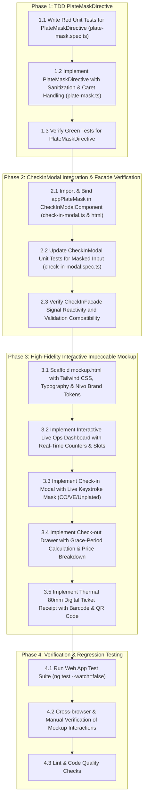

# Implementation Tasks: Colombian & Venezuelan Plate Masks + Impeccable Live Operations Mockup

## Execution DAG & Workflow Routing

---

## Task Details

### Phase 1: TDD `PlateMaskDirective` (`apps/web/src/app/shared/directives/`)

- [ ] **Task 1.1: Write Red Unit Tests for `PlateMaskDirective`**
  - **File**: `apps/web/src/app/shared/directives/plate-mask.spec.ts`
  - **Details**:
    - Test host component containing `<input appPlateMask [country]="country" [vehicleType]="vehicleType">`.
    - Test Colombian car masking: typing `abc123` formats to `ABC-123`.
    - Test Colombian motorcycle masking: typing `abc12d` formats to `ABC-12D`.
    - Test Venezuelan masking: typing `ab123cd` formats to `AB-123-CD`.
    - Test non-alphanumeric sanitization: typing `a.b-c 1@2#3` formats to `ABC-123`.
    - Test progressive typing: `a` -> `A`, `ab` -> `AB`, `abc` -> `ABC`, `abc1` -> `ABC-1`.
    - Test backspace behavior: deleting when cursor is after hyphen correctly removes previous character.
    - Test unplated country: leaves input unmasked.
  - **Verification**: `rtk npx ng test --include="**/plate-mask.spec.ts" --watch=false` fails with missing directive (Red).

- [ ] **Task 1.2: Implement `PlateMaskDirective`**
  - **File**: `apps/web/src/app/shared/directives/plate-mask.ts`
  - **Details**:
    - Create standalone directive `[appPlateMask]` with `country` and `vehicleType` signal inputs.
    - Implement input sanitization (strip non-alphanumeric, auto-uppercase).
    - Implement caret position tracking using `rawCharsBeforeCursor` algorithm.
    - Implement `keydown` listener for seamless backspace handling across hyphens.
    - Implement formatting rules for Colombian Car (`AAA-000`), Colombian Motorcycle (`AAA-00A`), and Venezuelan (`AA-000-AA`).
    - Dispatch synthetic DOM `input` event on mutation to keep Angular form bindings in sync.
  - **Verification**: Unit tests pass (Green).

- [ ] **Task 1.3: Verify Green Unit Tests**
  - **Command**: `rtk npx ng test --include="**/plate-mask.spec.ts" --watch=false`
  - **Acceptance Criteria**: 100% of directive test scenarios pass.

---

### Phase 2: `CheckInModalComponent` Integration & Facade Verification

- [ ] **Task 2.1: Integrate `appPlateMask` in `CheckInModalComponent`**
  - **Files**:
    - `apps/web/src/app/features/operations/components/modals/check-in-modal/check-in-modal.ts`
    - `apps/web/src/app/features/operations/components/modals/check-in-modal/check-in-modal.html`
  - **Details**:
    - Import `PlateMaskDirective` in `CheckInModalComponent.imports`.
    - Add `appPlateMask [country]="facade.plateCountry()" [vehicleType]="facade.vehicleType()"` to `#plateInput`.
    - Verify `maxlength` adjustment or dynamic limit according to country/mask.
    - Ensure `onPlateInput` receives the masked string and updates `facade.setPlate(...)`.

- [ ] **Task 2.2: Update and Run `CheckInModalComponent` Tests**
  - **File**: `apps/web/src/app/features/operations/components/modals/check-in-modal/check-in-modal.spec.ts`
  - **Details**:
    - Add test cases verifying masked input formatting inside the check-in modal.
    - Verify country switcher (`CO` -> `VE`) triggers re-formatting of the current plate.
  - **Verification**: `rtk npx ng test --include="**/check-in-modal.spec.ts" --watch=false` passes.

- [ ] **Task 2.3: Verify `CheckInFacade` Validation Compatibility**
  - **File**: `apps/web/src/app/features/operations/facades/check-in-facade.spec.ts`
  - **Details**:
    - Verify `facade.isValid()` handles masked Colombian (`ABC-123`, `ABC-12D`) and Venezuelan (`AB-123-CD`) plates cleanly.
    - Verify submission payload contains valid plate format.
  - **Verification**: `rtk npx ng test --include="**/check-in-facade.spec.ts" --watch=false` passes.

---

### Phase 3: High-Fidelity Interactive Impeccable Mockup

- [ ] **Task 3.1: Scaffold `mockup.html` Architecture & Theme Tokens**
  - **File**: `openspec/changes/2026-10-16-plate-masks-and-live-ops/mockup.html`
  - **Details**:
    - Standalone single-file prototype with Tailwind CDN, Google Fonts (Inter + JetBrains Mono), and SVG icon definitions.
    - Top navigation bar: Nivo logo, tenant badge, parking lot selector ("Sede Centro - Cúcuta"), live clock, operational shift indicator.
    - View tabs: "Live Operations Dashboard", "Simulador Check-in", "Simulador Check-out", "Comprobante Térmico".

- [ ] **Task 3.2: Implement Live Ops Dashboard View**
  - **Details**:
    - Real-time KPI gauge cards: Total Plazas (120), Plazas Ocupadas (84), % Ocupación (70%), Facturación del Turno ($482.000 COP), Tiempo Promedio (1h 15m).
    - Interactive Active Tickets table: plate badge with country flag, vehicle type badge, assigned slot, entry time, elapsed stay counter, action buttons ("Cobrar / Salida", "Reimprimir").
    - Search & filter toolbar (by plate, slot number, or vehicle category).

- [ ] **Task 3.3: Implement Check-in Modal with Live Keystroke Masking Simulator**
  - **Details**:
    - Modal dialog mirroring `CheckInModalComponent` design.
    - Interactive country pills: `🇨🇴 Colombia`, `🇻🇪 Venezuela`, `🚫 Sin Placa`.
    - Vehicle type buttons: `Automóvil`, `Motocicleta`, `Bicicleta` with dynamic hourly rate display.
    - Plate input with instant Vanilla JS masking engine mirroring `PlateMaskDirective` rules:
      - CO Car: `AAA-000`
      - CO Moto: `AAA-00A`
      - VE: `AA-000-AA`
    - Live validation badge ("Formato Válido", "Incompleto", "Placa Duplicada").
    - Simulated ticket creation adding vehicle immediately to the active tickets table with toast notification.

- [ ] **Task 3.4: Implement Check-out Settlement Drawer**
  - **Details**:
    - Quick search by plate or scanning simulated ticket code.
    - Real-time stay calculator with rate application and 15-minute grace period indicator (Gratis / Sin cobro).
    - Itemized breakdown: Subtotal, IVA 19%, Descuento, Total a pagar.
    - Payment selector: Efectivo, Wompi QR / Transferencia, Salida Gratuita.
    - Action to release slot and mark ticket closed.

- [ ] **Task 3.5: Implement 80mm Digital Thermal Ticket Receipt Preview**
  - **Details**:
    - Pixel-perfect 80mm thermal receipt card with serrated edges, monospace typography, barcode simulation, and SVG QR code.
    - Metadata: Parking name, NIT, Ticket #, Plate, Entry time, Rate terms.
    - Action buttons: "Imprimir Ticket", "Enviar por WhatsApp", "Copiar Enlace Digital".

---

### Phase 4: Full Regression Testing & Quality Verification

- [ ] **Task 4.1: Run Full Web App Test Suite**
  - **Command**: `rtk npx ng test --watch=false`
  - **Details**: Verify no regressions across all components, directives, and facades.

- [ ] **Task 4.2: Manual Verification of Mockup Interactions**
  - **Details**: Open `mockup.html` in browser, test all masking variations, keyboard shortcuts (`Enter`, `Esc`), and tab transitions.

- [ ] **Task 4.3: Lint & Code Style Checks**
  - **Command**: `rtk npm run lint` (or project equivalent linter)
  - **Details**: Ensure strict TypeScript and Angular style conformance.
