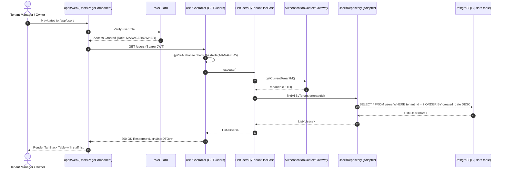

# Technical Design: Internal User & Role Management (ANC-49 / ANC-50)

## Architecture Overview

This feature delivers an end-to-end, multi-layered user and role management capability across the Nivo backend (`apps/api`) and web application (`apps/web`), structured under Clean Architecture on the backend and Standalone Component / Signal-driven architecture on the frontend.

```mermaid
flowchart TD
    subgraph Frontend["apps/web (Angular 19+)"]
        Sidebar["SidebarBase (Role-based link filtering)"]
        Guard["roleGuard(['OWNER', 'MANAGER', 'SUPERADMIN'])"]
        Page["UsersPageComponent"]
        Table["UsersTableComponent (TanStack Table)"]
        InviteModal["InviteUserModalComponent"]
        ModifyModal["ModifyRoleModalComponent"]
        DeactivateModal["DeactivateUserModalComponent"]
        Service["UserService (Signals & State)"]
    end

    subgraph Backend["apps/api (Spring Boot / Clean Architecture)"]
        Controller["UserController (REST Entrypoint)"]
        Security["@PreAuthorize('hasRole(\"MANAGER\")')"]
        UseCase["ListUsersByTenantUseCase"]
        AuthContext["AuthenticationContextGateway"]
        RepositoryPort["UsersRepository (Gateway Port)"]
        Adapter["UserRepositoryAdapter (Driven Adapter)"]
        JpaRepo["UserRepositoryData (Spring Data JPA)"]
        Database[(PostgreSQL Database)]
    end

    Sidebar -->|Navigates| Guard
    Guard -->|Allows Access| Page
    Page --> Table
    Page --> InviteModal
    Page --> ModifyModal
    Page --> DeactivateModal
    Table --> Service
    InviteModal --> Service
    ModifyModal --> Service
    DeactivateModal --> Service

    Service -->|HTTP GET /users| Controller
    Service -->|HTTP POST /users/invite-user| Controller
    Service -->|HTTP PATCH /users/modify-rol| Controller
    Service -->|HTTP DELETE /users/deactivate-user| Controller

    Controller --> Security
    Security --> UseCase
    UseCase --> AuthContext
    UseCase --> RepositoryPort
    RepositoryPort --> Adapter
    Adapter --> JpaRepo
    JpaRepo --> Database
```

---

## 1. Backend Architecture (`apps/api`)

### 1.1 Clean Architecture Layer Breakdown

The backend follows the established Hexagonal / Clean Architecture layout:

- **Domain Layer (`dev.angelcorzo.nivo.domain.usecase.user`)**:
  - `ListUsersByTenantUseCase`: Business use case responsible for orchestrating tenant user retrieval.
  - Resolves the caller's tenant context from `AuthenticationContextGateway.getCurrentTenantId()`.
  - Queries `UsersRepository.findAllByTenantId(tenantId)` and returns `List<Users>`.
- **Domain Gateway (`dev.angelcorzo.nivo.domain.model.users.gateways`)**:
  - Extends `UsersRepository` interface with `List<Users> findAllByTenantId(UUID tenantId)`.
- **Infrastructure Driven Adapter (`dev.angelcorzo.nivo.infrastructure.adapter.jpa.users`)**:
  - Extends `UserRepositoryData` with:
    ```java
    @EntityGraph(attributePaths = {"tenant"})
    @Query("SELECT u FROM UsersData u WHERE u.tenant.id = :tenantId ORDER BY u.createdDate DESC")
    List<UsersData> findAllByTenantId(@Param("tenantId") UUID tenantId);
    ```
  - Implements `findAllByTenantId(UUID tenantId)` in `UserRepositoryAdapter`, mapping JPA entities to Domain entities via `UserMapper`.
- **Infrastructure Entrypoint (`dev.angelcorzo.nivo.infrastructure.entrypoint.rest.users.controller`)**:
  - New endpoint in `UserController`:
    ```java
    @Operation(
        summary = "List users by tenant",
        description = "Retrieves all users belonging to the currently authenticated user's tenant")
    @ApiResponses({
      @ApiResponse(responseCode = "200", description = "Users retrieved successfully"),
      @ApiResponse(responseCode = "403", description = "Forbidden - Manager role required")
    })
    @GetMapping
    @PreAuthorize("hasRole('MANAGER')")
    Response<List<UserDTO>> getUsers() {
      final List<Users> users = this.listUsersByTenantUseCase.execute();
      return Response.ok(
          this.userMapper.toDTOList(users),
          UserMessages.USERS_RETRIEVED.toString());
    }
    ```
  - New entry in `UserMessages.java`: `USERS_RETRIEVED("Usuarios obtenidos con éxito")`.
  - Add `toDTOList` to `UserMapper.java`.

### 1.2 Sequence Flow: Tenant User Listing



---

## 2. Frontend Architecture (`apps/web`)

### 2.1 Security & Guard Protocol (`RoleGuard`)

To enforce strict RBAC boundaries on the frontend, a functional route guard `roleGuard` is introduced:

- **Location**: `apps/web/src/app/core/guards/auth/role-guard.ts`
- **Signature**: `roleGuard(allowedRoles: Role[]): CanActivateFn`
- **Behavior**:
  1. Injects `UserService` and `Router`.
  2. Inspects `userService.currentUser()`. If the signal is not yet populated, awaits user resolution or queries `userService.getCurrentUserSnapshot()`.
  3. Checks if `allowedRoles.includes(user.role)`.
  4. If authorized, returns `true`.
  5. If unauthorized, emits a warning toast notification via `ToastService` and returns a `UrlTree` redirecting to `/app/dashboard`.

```typescript
export const roleGuard = (allowedRoles: Role[]): CanActivateFn => {
  return () => {
    const userService = inject(UserService);
    const router = inject(Router);
    const toastService = inject(ToastService);

    const currentUser = userService.currentUser();
    if (!currentUser) {
      return router.createUrlTree([APP_ROUTES.auth.login]);
    }

    if (allowedRoles.includes(currentUser.role)) {
      return true;
    }

    toastService.error({
      title: "Acceso denegado",
      message: "No tienes permisos para acceder a este módulo",
    });
    return router.createUrlTree([APP_ROUTES.app.dashboard]);
  };
};
```

### 2.2 Navigation & Sidebar Filtering

- **Navigation Item**: Added to `APP_TEXTS.sidebar.nav`:
  ```typescript
  {
    icon: "lucideUsers",
    label: "Usuarios",
    url: APP_ROUTES.app.users,
    roles: ["SUPERADMIN", "OWNER", "MANAGER"],
  }
  ```
- **Conditional Visibility**: `SidebarBase` filters `navItems` using a computed signal derived from `userService.currentUser()`:
  - If the user's role is `OPERATOR`, `DRIVER`, or `AUDITOR`, the "Usuarios" menu item is stripped from the DOM.
  - Prevents UI leakage and confusing navigation traps.

### 2.3 User Service Enhancement (`UserService`)

- **Location**: `apps/web/src/app/core/services/user/user-service.ts`
- **State Signals**:
  - `currentUser = signal<UserModel | null>`
  - `users = signal<UserInfoModel[]>`
  - `isLoading = signal<boolean>`
- **Exposed Methods**:
  - `loadUsers(): Observable<UserInfoModel[]>`: Fetches tenant users from `/users` and updates `users` signal.
  - `inviteUser(data: InviteUserDTO): Observable<UserInvitationsDTO>`: Invokes `POST /users/invite-user`.
  - `modifyRole(userId: string, role: Role): Observable<UserModel>`: Invokes `PATCH /users/modify-rol` and updates local state.
  - `deactivateUser(userId: string): Observable<void>`: Invokes `DELETE /users/deactivate-user` and marks user as inactive in local state.

### 2.4 User Management Page & Components (`@features/users`)

Directory structure:

```
apps/web/src/app/features/users/
├── components/
│   ├── invite-user-modal/
│   │   ├── invite-user-modal.html
│   │   ├── invite-user-modal.spec.ts
│   │   └── invite-user-modal.ts
│   ├── modify-role-modal/
│   │   ├── modify-role-modal.html
│   │   ├── modify-role-modal.spec.ts
│   │   └── modify-role-modal.ts
│   ├── deactivate-user-modal/
│   │   ├── deactivate-user-modal.html
│   │   ├── deactivate-user-modal.spec.ts
│   │   └── deactivate-user-modal.ts
│   └── users-table/
│       ├── user-columns-definition.ts
│       ├── users-table.html
│       ├── users-table.spec.ts
│       └── users-table.ts
├── page/
│   ├── users-page/
│   │   ├── users-page.css
│   │   ├── users-page.html
│   │   ├── users-page.spec.ts
│   │   └── users-page.ts
│   └── users-page.facade.ts
```

#### TanStack Table Integration

- Columns:
  1. **Usuario**: Avatar with user initials, full name, and email.
  2. **Contacto**: Phone number or contact info (fallback to "N/A").
  3. **Rol**: Styled `@nivo-sass/design-system` Badge (`OWNER`: Purple, `MANAGER`: Blue, `OPERATOR`: Green, `AUDITOR`: Gray).
  4. **Estado**: Badge (`Activo` in emerald green, `Inactivo` in muted gray).
  5. **Fecha de Registro**: Formatted localized date (`dd/MM/yyyy`).
  6. **Acciones**: Contextual dropdown with "Cambiar rol" and "Desactivar usuario".
- Real-time client filtering for search queries (full name, email) and role dropdown selection.

#### Modal Dialogs (`@nivo-sass/design-system`)

- **`InviteUserModalComponent`**:
  - Accessible native `<dialog>` wrapper with backdrop blur and enter/exit animations.
  - Form Fields:
    - Correo Electrónico (`InputComponent` with email validator).
    - Nombre Completo (`InputComponent` with min 3 chars).
    - Teléfono de Contacto (`InputComponent` with numeric/tel format).
    - Rol Asignado (`SelectComponent` options: `OPERATOR`, `MANAGER`).
  - Submit triggers `userService.inviteUser()`, closes modal on success, and dispatches toast notification.
- **`ModifyRoleModalComponent`**:
  - Allows switching an active user between `OPERATOR` and `MANAGER`.
  - Disallows modifying the last active `OWNER`.
- **`DeactivateUserModalComponent`**:
  - Destructive confirmation prompt alerting that the staff member will immediately lose access to the system.
  - Prevents self-deactivation if `currentUser.id === targetUser.id`.

---

## 3. Security Contracts & RBAC Matrix

| Role           | Access `/app/users` | List Users (`GET /users`) | Invite User (`POST /invite`) | Modify Role (`PATCH /modify-rol`) | Deactivate (`DELETE /deactivate`) |
| :------------- | :-----------------: | :-----------------------: | :--------------------------: | :-------------------------------: | :-------------------------------: |
| **SUPERADMIN** |         Yes         |            Yes            |             Yes              |                Yes                |                Yes                |
| **OWNER**      |         Yes         |            Yes            |             Yes              |                Yes                |                Yes                |
| **MANAGER**    |         Yes         |            Yes            |             Yes              |                Yes                |                Yes                |
| **OPERATOR**   |  **No** (Redirect)  |       **No** (403)        |         **No** (403)         |           **No** (403)            |           **No** (403)            |
| **DRIVER**     |  **No** (Redirect)  |       **No** (403)        |         **No** (403)         |           **No** (403)            |           **No** (403)            |
| **AUDITOR**    |  **No** (Redirect)  |       **No** (403)        |         **No** (403)         |           **No** (403)            |           **No** (403)            |

### Invariants & Guardrails

1. **Self-Deactivation Guard**: A manager or owner cannot deactivate their own active account. Attempting this returns a client-side validation block and backend rejection.
2. **Owner Retention Guard**: A tenant must always possess at least one active `OWNER`. The backend enforces this via `UsersRepository.countActiveOwnersByTenantId`.
3. **Tenant Isolation**: Users can only view and manage users belonging to their own `tenant_id`. No cross-tenant access is permissible.

---

## 4. Error Handling & Defensive Resilience

| Failure Scenario                    | HTTP Code / UI State                                   | System Reaction                                                | User Feedback                                              |
| :---------------------------------- | :----------------------------------------------------- | :------------------------------------------------------------- | :--------------------------------------------------------- |
| Operator requests `/users`          | 403 Forbidden                                          | Interceptor catches 403, triggers redirect to `/app/dashboard` | Toast: _"No tienes permisos para acceder a este módulo"_   |
| Invite existing active user         | 400 Bad Request (`UserAlreadyExistsInTenantException`) | Backend rejects transaction                                    | Form Error: _"El usuario ya pertenece a este parqueadero"_ |
| Deactivate already deactivated user | 400 Bad Request (`UserAlreadyDeactivatedException`)    | Domain exception mapped to error response                      | Toast: _"El usuario ya se encuentra inactivo"_             |
| Network timeout during listing      | HTTP Error / Empty State                               | Component enters retry state                                   | Table empty state with "Reintentar" action                 |
