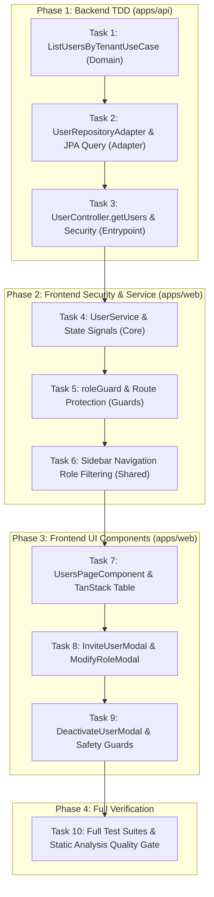

# Execution Plan: Internal User & Role Management (ANC-49 / ANC-50)

> **Context**: Implementation plan for multi-tenant internal user listing, role assignment, staff invitations, account deactivation, and client-side RBAC protection.
> **Architecture Standards**:
>
> - **Backend**: Spring Boot 4 / Java 21, Clean Architecture (domain-independent ports, JPA-driven adapters, entrypoint REST controllers with `@PreAuthorize("hasRole('MANAGER')")`).
> - **Frontend**: Angular 21, `ChangeDetectionStrategy.OnPush`, standalone components and functional guards, `@nivo-sass/design-system`, TanStack Table integration, zero emojis in templates.
> - **CLI & Conventions**: All terminal commands prefixed with `rtk`. Conventional commits with strict scopes (`feat(api/usecase)`, `feat(api/adapter)`, `feat(api/entry-point)`, `feat(web/auth)`, `feat(web/users)`), and strictly NO AI attribution trailers.

---

## Architecture DAG & Phase Progression



---

## Phase 1: Backend TDD (`apps/api`)

### Task 1: `UsersRepository` Gateway & `ListUsersByTenantUseCase` (Domain)

- **Target Files**:
  - Test: `apps/api/src/test/java/dev/angelcorzo/nivo/domain/usecase/user/ListUsersByTenantUseCaseTest.java`
  - Gateway: `apps/api/src/main/java/dev/angelcorzo/nivo/domain/model/users/gateways/UsersRepository.java`
  - Implementation: `apps/api/src/main/java/dev/angelcorzo/nivo/domain/usecase/user/ListUsersByTenantUseCase.java`

- **TDD Step 1: Red (Write Unit Tests)**:
  Create `ListUsersByTenantUseCaseTest.java` with Mockito:

  ```java
  package dev.angelcorzo.nivo.domain.usecase.user;

  import static org.junit.jupiter.api.Assertions.*;
  import static org.mockito.Mockito.*;

  import dev.angelcorzo.nivo.domain.model.authentication.gateway.AuthenticationContextGateway;
  import dev.angelcorzo.nivo.domain.model.tenants.valueobject.TenantReference;
  import dev.angelcorzo.nivo.domain.model.users.Users;
  import dev.angelcorzo.nivo.domain.model.users.enums.Roles;
  import dev.angelcorzo.nivo.domain.model.users.exceptions.UserAuthenticationContextInvalidException;
  import dev.angelcorzo.nivo.domain.model.users.gateways.UsersRepository;
  import java.time.OffsetDateTime;
  import java.util.List;
  import java.util.UUID;
  import org.junit.jupiter.api.DisplayName;
  import org.junit.jupiter.api.Test;
  import org.junit.jupiter.api.extension.ExtendWith;
  import org.mockito.InjectMocks;
  import org.mockito.Mock;
  import org.mockito.junit.jupiter.MockitoExtension;

  @ExtendWith(MockitoExtension.class)
  @DisplayName("ListUsersByTenantUseCase - Unit Tests")
  class ListUsersByTenantUseCaseTest {

    @Mock private UsersRepository usersRepository;
    @Mock private AuthenticationContextGateway authenticationContextGateway;

    @InjectMocks private ListUsersByTenantUseCase listUsersByTenantUseCase;

    @Test
    @DisplayName("Should return list of users for authenticated tenant")
    void shouldReturnListOfUsers_whenTenantHasUsers() {
      final UUID tenantId = UUID.randomUUID();
      final Users user1 = Users.builder()
          .id(UUID.randomUUID())
          .fullName("Alice Manager")
          .email("alice@test.com")
          .role(Roles.MANAGER)
          .tenant(TenantReference.builder().id(tenantId).companyName("Nivo Corp").build())
          .createdAt(OffsetDateTime.now())
          .build();
      final Users user2 = Users.builder()
          .id(UUID.randomUUID())
          .fullName("Bob Operator")
          .email("bob@test.com")
          .role(Roles.OPERATOR)
          .tenant(TenantReference.builder().id(tenantId).companyName("Nivo Corp").build())
          .createdAt(OffsetDateTime.now().minusDays(1))
          .build();

      when(authenticationContextGateway.getCurrentTenantId()).thenReturn(tenantId);
      when(usersRepository.findAllByTenantId(tenantId)).thenReturn(List.of(user1, user2));

      List<Users> result = listUsersByTenantUseCase.execute();

      assertNotNull(result);
      assertEquals(2, result.size());
      assertEquals("Alice Manager", result.get(0).getFullName());
      verify(authenticationContextGateway, times(1)).getCurrentTenantId();
      verify(usersRepository, times(1)).findAllByTenantId(tenantId);
    }

    @Test
    @DisplayName("Should return empty list when tenant has no additional users")
    void shouldReturnEmptyList_whenTenantHasNoUsers() {
      final UUID tenantId = UUID.randomUUID();
      when(authenticationContextGateway.getCurrentTenantId()).thenReturn(tenantId);
      when(usersRepository.findAllByTenantId(tenantId)).thenReturn(List.of());

      List<Users> result = listUsersByTenantUseCase.execute();

      assertNotNull(result);
      assertTrue(result.isEmpty());
      verify(usersRepository, times(1)).findAllByTenantId(tenantId);
    }

    @Test
    @DisplayName("Should propagate exception when authentication context fails")
    void shouldPropagateException_whenAuthenticationContextFails() {
      when(authenticationContextGateway.getCurrentTenantId())
          .thenThrow(new UserAuthenticationContextInvalidException());

      assertThrows(
          UserAuthenticationContextInvalidException.class,
          () -> listUsersByTenantUseCase.execute());
      verifyNoInteractions(usersRepository);
    }
  }
  ```

- **TDD Step 2: Red Verification Command**:

  ```bash
  rtk ./gradlew test --tests dev.angelcorzo.nivo.domain.usecase.user.ListUsersByTenantUseCaseTest
  ```

  _Expected Output_: Compilation failure (class `ListUsersByTenantUseCase` does not exist yet).

- **TDD Step 3: Green (Implement Port & UseCase)**:
  1. Add method to `UsersRepository.java`:
     ```java
     /**
      * Retrieves all active users associated with a specific tenant.
      *
      * @param tenantId The unique identifier of the tenant.
      * @return A list of {@link Users} entities belonging to the tenant.
      */
     List<Users> findAllByTenantId(UUID tenantId);
     ```
  2. Implement `ListUsersByTenantUseCase.java`:

     ```java
     package dev.angelcorzo.nivo.domain.usecase.user;

     import dev.angelcorzo.nivo.domain.model.authentication.gateway.AuthenticationContextGateway;
     import dev.angelcorzo.nivo.domain.model.users.Users;
     import dev.angelcorzo.nivo.domain.model.users.gateways.UsersRepository;
     import java.util.List;
     import java.util.UUID;
     import lombok.RequiredArgsConstructor;

     /**
      * Use case for retrieving all users belonging to the currently authenticated tenant.
      *
      * <p><strong>Layer:</strong> Application (Use Case)</p>
      */
     @RequiredArgsConstructor
     public class ListUsersByTenantUseCase {
       private final UsersRepository usersRepository;
       private final AuthenticationContextGateway authenticationContextGateway;

       public List<Users> execute() {
         final UUID tenantId = this.authenticationContextGateway.getCurrentTenantId();
         return this.usersRepository.findAllByTenantId(tenantId);
       }
     }
     ```

- **TDD Step 4: Green Verification Command**:

  ```bash
  rtk ./gradlew test --tests dev.angelcorzo.nivo.domain.usecase.user.ListUsersByTenantUseCaseTest
  ```

  _Expected Output_: BUILD SUCCESSFUL, 3 passed.

- **TDD Step 5: Refactor / Clean Architecture Validation**:
  Confirm that `ListUsersByTenantUseCase` depends only on domain model interfaces (`UsersRepository`, `AuthenticationContextGateway`) with zero Spring framework imports.

- **TDD Step 6: Atomic Commit**:
  ```bash
  rtk git add apps/api/src/main/java/dev/angelcorzo/nivo/domain/model/users/gateways/UsersRepository.java \
               apps/api/src/main/java/dev/angelcorzo/nivo/domain/usecase/user/ListUsersByTenantUseCase.java \
               apps/api/src/test/java/dev/angelcorzo/nivo/domain/usecase/user/ListUsersByTenantUseCaseTest.java
  rtk git commit -m "feat(api/usecase): implement ListUsersByTenantUseCase and domain port"
  ```

---

### Task 2: `UserRepositoryAdapter` & JPA Query (Adapter)

- **Target Files**:
  - Test: `apps/api/src/test/java/dev/angelcorzo/nivo/infrastructure/adapter/jpa/users/UserRepositoryAdapterTest.java`
  - Spring Data Repo: `apps/api/src/main/java/dev/angelcorzo/nivo/infrastructure/adapter/jpa/users/UserRepositoryData.java`
  - Adapter: `apps/api/src/main/java/dev/angelcorzo/nivo/infrastructure/adapter/jpa/users/UserRepositoryAdapter.java`

- **TDD Step 1: Red (Add Unit Test in Adapter Test Suite)**:
  In `UserRepositoryAdapterTest.java`, add the test:

  ```java
  @Test
  @DisplayName("Should find all users by tenant ID and return mapped domain entities")
  void shouldFindAllByTenantId() {
    UUID tenantId = UUID.randomUUID();
    UsersData userData = UsersData.builder().id(UUID.randomUUID()).email("staff@tenant.com").build();
    Users userEntity = Users.builder().id(userData.getId()).email(userData.getEmail()).build();

    when(repository.findAllByTenantId(tenantId)).thenReturn(List.of(userData));
    when(mapper.toEntity(userData)).thenReturn(userEntity);

    List<Users> result = adapter.findAllByTenantId(tenantId);

    assertThat(result).isNotNull();
    assertThat(result).hasSize(1);
    assertThat(result.get(0).getEmail()).isEqualTo("staff@tenant.com");
    verify(repository, times(1)).findAllByTenantId(tenantId);
  }
  ```

- **TDD Step 2: Red Verification Command**:

  ```bash
  rtk ./gradlew test --tests dev.angelcorzo.nivo.infrastructure.adapter.jpa.users.UserRepositoryAdapterTest
  ```

  _Expected Output_: Compilation error (`findAllByTenantId` undefined on `UserRepositoryData` / `UserRepositoryAdapter`).

- **TDD Step 3: Green (Implement JPA Query & Adapter Method)**:
  1. In `UserRepositoryData.java`:
     ```java
     /**
      * Finds all active users for a tenant ordered by creation date descending.
      *
      * @param tenantId The unique identifier of the tenant.
      * @return List of UsersData records with tenant eager-loaded.
      */
     @EntityGraph(attributePaths = {"tenant"})
     @Query("SELECT u FROM UsersData u WHERE u.tenant.id = :tenantId ORDER BY u.createdAt DESC")
     List<UsersData> findAllByTenantId(@Param("tenantId") UUID tenantId);
     ```
  2. In `UserRepositoryAdapter.java`:
     ```java
     @Override
     @Transactional(readOnly = true)
     public List<Users> findAllByTenantId(UUID tenantId) {
       return toList(this.repository.findAllByTenantId(tenantId));
     }
     ```

- **TDD Step 4: Green Verification Command**:

  ```bash
  rtk ./gradlew test --tests dev.angelcorzo.nivo.infrastructure.adapter.jpa.users.UserRepositoryAdapterTest
  ```

  _Expected Output_: BUILD SUCCESSFUL, all unit tests passed.

- **TDD Step 5: Refactor / Clean Architecture Validation**:
  Ensure `@EntityGraph(attributePaths = {"tenant"})` prevents N+1 queries when mapping domain aggregates.

- **TDD Step 6: Atomic Commit**:
  ```bash
  rtk git add apps/api/src/main/java/dev/angelcorzo/nivo/infrastructure/adapter/jpa/users/UserRepositoryData.java \
               apps/api/src/main/java/dev/angelcorzo/nivo/infrastructure/adapter/jpa/users/UserRepositoryAdapter.java \
               apps/api/src/test/java/dev/angelcorzo/nivo/infrastructure/adapter/jpa/users/UserRepositoryAdapterTest.java
  rtk git commit -m "feat(api/adapter): add findAllByTenantId query and adapter implementation"
  ```

---

### Task 3: `UserController.getUsers` Endpoint & Security (Entry-point)

- **Target Files**:
  - Test: `apps/api/src/test/java/dev/angelcorzo/nivo/infrastructure/entrypoint/rest/users/controller/UserControllerTest.java`
  - Messages: `apps/api/src/main/java/dev/angelcorzo/nivo/infrastructure/entrypoint/rest/users/enums/UserMessages.java`
  - Mapper: `apps/api/src/main/java/dev/angelcorzo/nivo/infrastructure/entrypoint/rest/users/mappers/UserMapper.java`
  - Controller: `apps/api/src/main/java/dev/angelcorzo/nivo/infrastructure/entrypoint/rest/users/controller/UserController.java`

- **TDD Step 1: Red (Add Controller Endpoint Test)**:
  In `UserControllerTest.java`:

  ```java
  @MockitoBean private ListUsersByTenantUseCase listUsersByTenantUseCase;

  @Test
  @DisplayName("GET /users - Should return 200 OK and list of users for tenant")
  void getUsers_shouldReturn200AndUserList() throws Exception {
    final UUID userId = UUID.randomUUID();
    final Users domainUser = Users.builder().id(userId).fullName("Carlos Manager").build();
    final UserDTO userDto = UserDTO.builder().id(userId).fullName("Carlos Manager").build();

    when(listUsersByTenantUseCase.execute()).thenReturn(List.of(domainUser));
    when(userMapper.toDTOList(List.of(domainUser))).thenReturn(List.of(userDto));

    mockMvc
        .perform(get("/users").accept(MediaType.APPLICATION_JSON))
        .andExpect(status().isOk())
        .andExpect(jsonPath("$.message").value(UserMessages.USERS_RETRIEVED.toString()))
        .andExpect(jsonPath("$.data[0].id").value(userId.toString()))
        .andExpect(jsonPath("$.data[0].fullName").value("Carlos Manager"));
  }
  ```

- **TDD Step 2: Red Verification Command**:

  ```bash
  rtk ./gradlew test --tests dev.angelcorzo.nivo.infrastructure.entrypoint.rest.users.controller.UserControllerTest
  ```

  _Expected Output_: Compilation error (`USERS_RETRIEVED` or `toDTOList` missing).

- **TDD Step 3: Green (Implement Messages, Mapper & Endpoint)**:
  1. In `UserMessages.java`:
     Add enum constant `USERS_RETRIEVED("Usuarios obtenidos con éxito")`.
  2. In `UserMapper.java`:
     Add method `List<UserDTO> toDTOList(List<Users> users);`.
  3. In `UserController.java`:
     Inject `ListUsersByTenantUseCase` and declare the endpoint:

     ```java
     private final ListUsersByTenantUseCase listUsersByTenantUseCase;

     @Operation(
         summary = "List users by tenant",
         description = "Retrieves all users belonging to the currently authenticated user's tenant")
     @ApiResponses({
       @ApiResponse(responseCode = "200", description = "Users retrieved successfully"),
       @ApiResponse(responseCode = "403", description = "Forbidden - Manager role required")
     })
     @GetMapping
     @PreAuthorize("hasRole('MANAGER')")
     Response<List<UserDTO>> getUsers() {
       final List<Users> users = this.listUsersByTenantUseCase.execute();
       return Response.ok(
           this.userMapper.toDTOList(users),
           UserMessages.USERS_RETRIEVED.toString());
     }
     ```

- **TDD Step 4: Green Verification Command**:

  ```bash
  rtk ./gradlew test --tests dev.angelcorzo.nivo.infrastructure.entrypoint.rest.users.controller.UserControllerTest
  ```

  _Expected Output_: BUILD SUCCESSFUL, all controller tests pass.

- **TDD Step 5: Refactor / Clean Architecture Validation**:
  Verify endpoint security specifies `@PreAuthorize("hasRole('MANAGER')")` so hierarchy rules grant access to `MANAGER`, `OWNER`, and `SUPERADMIN`, while blocking `OPERATOR`.

- **TDD Step 6: Atomic Commit**:
  ```bash
  rtk git add apps/api/src/main/java/dev/angelcorzo/nivo/infrastructure/entrypoint/rest/users/ \
               apps/api/src/test/java/dev/angelcorzo/nivo/infrastructure/entrypoint/rest/users/controller/UserControllerTest.java
  rtk git commit -m "feat(api/entry-point): expose GET /users endpoint with manager authorization"
  ```

---

## Phase 2: Frontend Security & Service Layer (`apps/web`)

### Task 4: `UserService` & DTO Models (Core)

- **Target Files**:
  - Test: `apps/web/src/app/core/services/user/user-service.spec.ts`
  - Model: `apps/web/src/app/core/models/user.model.ts`
  - Mapper: `apps/web/src/app/core/mappers/user.mapper.ts`
  - Service: `apps/web/src/app/core/services/user/user-service.ts`

- **TDD Step 1: Red (Write Tests for Roster State Signals & Actions)**:
  In `apps/web/src/app/core/services/user/user-service.spec.ts`:

  ```typescript
  it("should initialize users signal with empty array and isLoading as false", () => {
    expect(service.users()).toEqual([]);
    expect(service.isLoading()).toBe(false);
  });

  it("should load users and populate users signal on loadUsers()", () => {
    const mockUsersResponse = {
      data: [
        {
          id: "u-1",
          fullName: "Maria Admin",
          email: "maria@test.com",
          role: "MANAGER" as const,
          contactInfo: "3001234567",
          createdAt: "2026-01-01T00:00:00.000Z",
        },
      ],
      message: "OK",
      status: "200",
      timestamp: "2026-01-01T00:00:00.000Z",
    };

    usersServiceSpy.getUsers = vi.fn().mockReturnValue(of(mockUsersResponse));

    service.loadUsers().subscribe();

    expect(usersServiceSpy.getUsers).toHaveBeenCalledTimes(1);
    expect(service.users().length).toBe(1);
    expect(service.users()[0].fullName).toBe("Maria Admin");
    expect(service.isLoading()).toBe(false);
  });

  it("should update user role in users signal on modifyRole()", () => {
    service["usersSignal"].set([
      {
        id: "u-1",
        fullName: "User One",
        email: "user@test.com",
        role: "OPERATOR",
        contactInfo: "",
        createdAt: new Date(),
      },
    ]);

    const modifyResponse = {
      data: { id: "u-1", role: "MANAGER" as const },
      message: "Updated",
      status: "200",
      timestamp: "2026-01-01T00:00:00.000Z",
    };
    usersServiceSpy.modifyRol = vi.fn().mockReturnValue(of(modifyResponse));

    service.modifyRole("u-1", "MANAGER").subscribe();

    expect(service.users()[0].role).toBe("MANAGER");
  });

  it("should mark user as inactive on deactivateUser()", () => {
    service["usersSignal"].set([
      {
        id: "u-1",
        fullName: "User One",
        email: "user@test.com",
        role: "OPERATOR",
        contactInfo: "",
        createdAt: new Date(),
        deletedAt: null,
      },
    ]);

    usersServiceSpy.deactivateUser = vi.fn().mockReturnValue(of({ message: "Deactivated" }));

    service.deactivateUser("u-1").subscribe();

    expect(service.users()[0].deletedAt).toBeDefined();
  });
  ```

- **TDD Step 2: Red Verification Command**:

  ```bash
  rtk bun run --cwd apps/web ng test --include="**/user-service.spec.ts" --watch=false
  ```

  _Expected Output_: Test failures due to missing `users`, `isLoading`, and mutation methods on `UserService`.

- **TDD Step 3: Green (Implement UserService & Models)**:
  1. In `apps/web/src/app/core/models/user.model.ts`:
     Extend `UserInfoModel`:
     ```typescript
     export interface UserInfoModel {
       id: string;
       fullName: string;
       email: string;
       role: Role;
       contactInfo: string;
       createdAt?: Date;
       deletedAt?: Date | null;
     }
     ```
  2. In `apps/web/src/app/core/mappers/user.mapper.ts`:
     Add mapping helper `mapToUserInfoModel(dto: UserDto): UserInfoModel`.
  3. In `apps/web/src/app/core/services/user/user-service.ts`:

     ```typescript
     private readonly usersSignal = signal<UserInfoModel[]>([]);
     public readonly users = this.usersSignal.asReadonly();

     private readonly isLoadingSignal = signal<boolean>(false);
     public readonly isLoading = this.isLoadingSignal.asReadonly();

     public loadUsers(): Observable<UserInfoModel[]> {
       this.isLoadingSignal.set(true);
       return this.usersService.getUsers().pipe(
         map((response) => (response.data ?? []).map(mapToUserInfoModel)),
         tap({
           next: (users) => this.usersSignal.set(users),
           finalize: () => this.isLoadingSignal.set(false),
         })
       );
     }

     public inviteUser(data: InviteUserDto): Observable<ResponseUserInvitationsDto> {
       return this.usersService.inviteUserWithRol({ body: data }).pipe(
         tap(() => this.loadUsers().subscribe())
       );
     }

     public modifyRole(userId: string, role: Role): Observable<void> {
       return this.usersService.modifyRol({ body: { userId, role } }).pipe(
         tap(() => {
           this.usersSignal.update((users) =>
             users.map((u) => (u.id === userId ? { ...u, role } : u))
           );
         }),
         map(() => void 0)
       );
     }

     public deactivateUser(userId: string): Observable<void> {
       return this.usersService.deactivateUser({ body: { userId } }).pipe(
         tap(() => {
           this.usersSignal.update((users) =>
             users.map((u) =>
               u.id === userId ? { ...u, deletedAt: new Date() } : u
             )
           );
         }),
         map(() => void 0)
       );
     }
     ```

- **TDD Step 4: Green Verification Command**:

  ```bash
  rtk bun run --cwd apps/web ng test --include="**/user-service.spec.ts" --watch=false
  ```

  _Expected Output_: All test cases passing green.

- **TDD Step 5: Refactor / Clean Architecture Validation**:
  Ensure state signals expose readonly getters to maintain unidirectional data flow.

- **TDD Step 6: Atomic Commit**:
  ```bash
  rtk git add apps/web/src/app/core/services/user/ \
               apps/web/src/app/core/models/user.model.ts \
               apps/web/src/app/core/mappers/user.mapper.ts
  rtk git commit -m "feat(web/users): extend UserService with roster state signals and lifecycle mutations"
  ```

---

### Task 5: `roleGuard` & Route Protection

- **Target Files**:
  - Test: `apps/web/src/app/core/guards/auth/role.guard.spec.ts`
  - Guard: `apps/web/src/app/core/guards/auth/role.guard.ts`
  - Routes: `apps/web/src/app/app.routes.ts`
  - Route Constants: `apps/web/src/app/shared/constants/app-routes.constant.ts`

- **TDD Step 1: Red (Write Tests for RBAC Route Guard)**:
  Create `apps/web/src/app/core/guards/auth/role.guard.spec.ts`:

  ```typescript
  import { signal } from "@angular/core";
  import { TestBed } from "@angular/core/testing";
  import { Router } from "@angular/router";
  import { UserService } from "@core/services/user/user-service";
  import { ToastService } from "@nivo-sass/design-system";
  import { APP_ROUTES } from "@shared/constants/app-routes.constant";
  import { roleGuard } from "./role.guard";

  describe("roleGuard", () => {
    let router: Router;
    let toastService: { error: ReturnType<typeof vi.fn> };
    const currentUserSignal = signal<any>(null);

    beforeEach(() => {
      currentUserSignal.set(null);
      toastService = { error: vi.fn() };

      TestBed.configureTestingModule({
        providers: [
          {
            provide: UserService,
            useValue: { currentUser: currentUserSignal.asReadonly() },
          },
          { provide: ToastService, useValue: toastService },
        ],
      });
      router = TestBed.inject(Router);
    });

    it("should allow navigation when user role is included in allowedRoles", () => {
      currentUserSignal.set({ role: "MANAGER" });
      const guard = roleGuard(["OWNER", "MANAGER"]);

      const result = TestBed.runInInjectionContext(() => guard({} as any, {} as any));

      expect(result).toBe(true);
    });

    it("should redirect to dashboard and show error toast when user has disallowed role", () => {
      currentUserSignal.set({ role: "OPERATOR" });
      const guard = roleGuard(["OWNER", "MANAGER"]);

      const result = TestBed.runInInjectionContext(() => guard({} as any, {} as any));

      expect(result).toEqual(router.createUrlTree([APP_ROUTES.app.dashboard]));
      expect(toastService.error).toHaveBeenCalledTimes(1);
    });

    it("should redirect to login when user is not authenticated", () => {
      currentUserSignal.set(null);
      const guard = roleGuard(["OWNER", "MANAGER"]);

      const result = TestBed.runInInjectionContext(() => guard({} as any, {} as any));

      expect(result).toEqual(router.createUrlTree([APP_ROUTES.auth.login]));
    });
  });
  ```

- **TDD Step 2: Red Verification Command**:

  ```bash
  rtk bun run --cwd apps/web ng test --include="**/role.guard.spec.ts" --watch=false
  ```

  _Expected Output_: Test failure (guard not found).

- **TDD Step 3: Green (Implement roleGuard & Route Entry)**:
  1. Implement `role.guard.ts`:

     ```typescript
     import { inject } from "@angular/core";
     import type { CanActivateFn } from "@angular/router";
     import { Router } from "@angular/router";
     import type { Role } from "@core/type/role.type";
     import { UserService } from "@core/services/user/user-service";
     import { ToastService } from "@nivo-sass/design-system";
     import { APP_ROUTES } from "@shared/constants/app-routes.constant";

     export const roleGuard = (allowedRoles: Role[]): CanActivateFn => {
       return () => {
         const userService = inject(UserService);
         const router = inject(Router);
         const toastService = inject(ToastService);

         const currentUser = userService.currentUser();
         if (!currentUser) {
           return router.createUrlTree([APP_ROUTES.auth.login]);
         }

         if (allowedRoles.includes(currentUser.role)) {
           return true;
         }

         toastService.error({
           title: "Acceso denegado",
           message: "No tienes permisos para acceder a este módulo",
         });
         return router.createUrlTree([APP_ROUTES.app.dashboard]);
       };
     };
     ```

  2. In `app-routes.constant.ts`:
     Add `users: "users"` under `APP_ROUTE_PATHS.app`, and `users: "/app/users"` under `APP_ROUTES.app`.
  3. In `app.routes.ts`:
     Register `/app/users` route under authenticated children:
     ```typescript
     {
       canActivate: [authGuard, roleGuard(["SUPERADMIN", "OWNER", "MANAGER"])],
       data: {
         breadcrumb: {
           icon: "lucideUsers",
           label: "Usuarios",
         } satisfies RouteBreadcrumb,
         navContext: {
           isRoot: true,
           scope: "tenant",
           section: "Administración",
           title: "Usuarios",
         } satisfies RouteNavContext,
       },
       loadComponent: async () => {
         const m = await import("@features/users/page/users-page/users-page");
         return m.UsersPageComponent;
       },
       path: APP_ROUTE_PATHS.app.users,
       title: "Usuarios",
     }
     ```

- **TDD Step 4: Green Verification Command**:

  ```bash
  rtk bun run --cwd apps/web ng test --include="**/role.guard.spec.ts" --watch=false
  ```

  _Expected Output_: All guard specifications pass green.

- **TDD Step 5: Refactor / Clean Architecture Validation**:
  Confirm route uses lazy-loaded component pattern with standalone route definition.

- **TDD Step 6: Atomic Commit**:
  ```bash
  rtk git add apps/web/src/app/core/guards/auth/ \
               apps/web/src/app/app.routes.ts \
               apps/web/src/app/shared/constants/app-routes.constant.ts
  rtk git commit -m "feat(web/auth): implement roleGuard and attach to users route"
  ```

---

### Task 6: Sidebar Navigation Permission Filtering

- **Target Files**:
  - Test: `apps/web/src/app/shared/components/sidebar/sidebar-base/sidebar-base.spec.ts`
  - Component: `apps/web/src/app/shared/components/sidebar/sidebar-base/sidebar-base.ts`
  - Texts: `apps/web/src/app/shared/constants/app-texts.constant.ts`

- **TDD Step 1: Red (Add Role Filtering Tests for Sidebar)**:
  In `sidebar-base.spec.ts`:

  ```typescript
  it("should show Usuarios nav item when user has OWNER role", () => {
    const userService = TestBed.inject(UserService);
    (userService.currentUser as any).set({ role: "OWNER" });
    fixture.detectChanges();

    const usersLink = component.navItems().find((item) => item.label === "Usuarios");
    expect(usersLink).toBeDefined();
  });

  it("should hide Usuarios nav item when user has OPERATOR role", () => {
    const userService = TestBed.inject(UserService);
    (userService.currentUser as any).set({ role: "OPERATOR" });
    fixture.detectChanges();

    const usersLink = component.navItems().find((item) => item.label === "Usuarios");
    expect(usersLink).toBeUndefined();
  });
  ```

- **TDD Step 2: Red Verification Command**:

  ```bash
  rtk bun run --cwd apps/web ng test --include="**/sidebar-base.spec.ts" --watch=false
  ```

  _Expected Output_: Test failure (Usuarios item either missing or not filtered).

- **TDD Step 3: Green (Implement Role-Aware Navigation)**:
  1. In `app-texts.constant.ts`:
     Add `roles?: Role[]` to nav item definitions and declare:
     ```typescript
     {
       icon: "lucideUsers",
       label: "Usuarios",
       url: APP_ROUTES.app.users,
       roles: ["SUPERADMIN", "OWNER", "MANAGER"],
     }
     ```
  2. In `sidebar-base.ts`:
     Inject `UserService`, import `lucideUsers` icon, and use a computed signal to filter `navItems`:

     ```typescript
     private readonly userService = inject(UserService);

     public readonly navItems = computed(() => {
       const userRole = this.userService.currentUser()?.role;
       return APP_TEXTS.sidebar.nav
         .filter((item) => !item.roles || (userRole && item.roles.includes(userRole)))
         .map((item) => ({
           ...item,
           isActive: Boolean(item.url && this.currentUrl().includes(item.url)),
         }));
     });
     ```

- **TDD Step 4: Green Verification Command**:

  ```bash
  rtk bun run --cwd apps/web ng test --include="**/sidebar-base.spec.ts" --watch=false
  ```

  _Expected Output_: All sidebar tests pass green.

- **TDD Step 5: Refactor / Clean Architecture Validation**:
  Ensure zero template duplication and verify icon provider includes `lucideUsers`.

- **TDD Step 6: Atomic Commit**:
  ```bash
  rtk git add apps/web/src/app/shared/components/sidebar/ \
               apps/web/src/app/shared/constants/app-texts.constant.ts
  rtk git commit -m "feat(web/users): filter sidebar navigation items by user role"
  ```

---

## Phase 3: Frontend UI Components (`apps/web`)

### Task 7: `UsersPageComponent` & TanStack Table with `@nivo-sass/design-system`

- **Target Files**:
  - Column Definition: `apps/web/src/app/features/users/components/users-table/user-columns-definition.ts`
  - Table Component: `apps/web/src/app/features/users/components/users-table/users-table.ts`, `.html`
  - Table Test: `apps/web/src/app/features/users/components/users-table/users-table.spec.ts`
  - Page Facade: `apps/web/src/app/features/users/page/users-page.facade.ts`
  - Page Component: `apps/web/src/app/features/users/page/users-page/users-page.ts`, `.html`, `.css`
  - Page Test: `apps/web/src/app/features/users/page/users-page/users-page.spec.ts`

- **TDD Step 1: Red (Write Tests for Table & Page)**:
  1. `users-table.spec.ts`:
     - Test table creation with `createColumnHelper<UserInfoModel>()`.
     - Test column headers: "Usuario", "Contacto", "Rol", "Estado", "Fecha de Registro", "Acciones".
     - Test badge rendering: Purple for `OWNER`, Blue for `MANAGER`, Green for `OPERATOR`.
     - Test status badge: "Activo" (green) vs "Inactivo" (gray).
  2. `users-page.spec.ts`:
     - Test KPI cards calculation: Total users, Active operators, Managers, Deactivated.
     - Test search input filtering by user name or email.
     - Test role chip filter filtering table rows.
     - Verify `OnPush` strategy and zero emojis in template HTML.

- **TDD Step 2: Red Verification Command**:

  ```bash
  rtk bun run --cwd apps/web ng test --include="**/users-table.spec.ts" --include="**/users-page.spec.ts" --watch=false
  ```

  _Expected Output_: Test failure (components do not exist).

- **TDD Step 3: Green (Implement UsersTable & UsersPage)**:
  1. Create `user-columns-definition.ts`:
     - Define columns using TanStack `createColumnHelper<UserInfoModel>()`.
     - Render avatar with initials (`AvatarComponent`), name, and email in first column.
     - Render role badge with `@nivo-sass/design-system` `BadgeComponent`.
     - Render status badge (`Activo` / `Inactivo`).
     - Render contextual action menu with outputs for "Cambiar Rol" and "Desactivar".
  2. Create `UsersTableComponent`:
     - Standalone, `ChangeDetectionStrategy.OnPush`.
     - Uses `DataTableComponent`, `DataTablePaginationComponent`, `EmptyStateDirective`.
  3. Create `UsersPageFacade`:
     - Injects `UserService`.
     - Computes reactive KPI signals: `totalUsers()`, `activeOperators()`, `managers()`, `deactivatedUsers()`.
     - Handles TanStack Table state (search query, role filter, sorting, pagination).
  4. Create `UsersPageComponent`:
     - Displays page header with action button "Invitar Usuario".
     - Displays 4 metric KPI cards with `CardComponent`.
     - Integrates search input, role filter tabs, and `UsersTableComponent`.

- **TDD Step 4: Green Verification Command**:

  ```bash
  rtk bun run --cwd apps/web ng test --include="**/users-table.spec.ts" --include="**/users-page.spec.ts" --watch=false
  ```

  _Expected Output_: All table and page tests pass green.

- **TDD Step 5: Refactor / Clean Architecture Validation**:
  Verify UI copy references `APP_TEXTS.users` with Spanish localization and zero template hardcoded strings or emojis.

- **TDD Step 6: Atomic Commit**:
  ```bash
  rtk git add apps/web/src/app/features/users/components/users-table/ \
               apps/web/src/app/features/users/page/
  rtk git commit -m "feat(web/users): implement UsersPageComponent and TanStack UsersTableComponent"
  ```

---

### Task 8: `InviteUserModalComponent` & Role Modification Modal

- **Target Files**:
  - Invite Modal:
    - `apps/web/src/app/features/users/components/invite-user-modal/invite-user-modal.ts`
    - `apps/web/src/app/features/users/components/invite-user-modal/invite-user-modal.html`
    - `apps/web/src/app/features/users/components/invite-user-modal/invite-user-modal.spec.ts`
  - Modify Role Modal:
    - `apps/web/src/app/features/users/components/modify-role-modal/modify-role-modal.ts`
    - `apps/web/src/app/features/users/components/modify-role-modal/modify-role-modal.html`
    - `apps/web/src/app/features/users/components/modify-role-modal/modify-role-modal.spec.ts`

- **TDD Step 1: Red (Write Tests for Invite & Modify Role Modals)**:
  1. `invite-user-modal.spec.ts`:
     - Test form field validation (email required & valid format, fullName min 3 chars, contactInfo required, role required).
     - Test valid submit calls `userService.inviteUser()`.
     - Test displays toast notification and closes modal on success.
  2. `modify-role-modal.spec.ts`:
     - Test role selector populated with assignable roles (`OPERATOR`, `MANAGER`).
     - Test submitting triggers `userService.modifyRole(userId, newRole)`.

- **TDD Step 2: Red Verification Command**:

  ```bash
  rtk bun run --cwd apps/web ng test --include="**/invite-user-modal.spec.ts" --include="**/modify-role-modal.spec.ts" --watch=false
  ```

  _Expected Output_: Test failure (modals not yet implemented).

- **TDD Step 3: Green (Implement Modals with Design System)**:
  1. Implement `InviteUserModalComponent`:
     - Native accessible `<dialog>` component with backdrop blur.
     - Reactive form with `InputComponent`, `SelectComponent`, and `ButtonComponent`.
     - Submits payload to `UserService.inviteUser()` and resets form on complete.
  2. Implement `ModifyRoleModalComponent`:
     - Accessible dialog displaying user's name and current role.
     - `SelectComponent` allowing selection of new role.
     - Submits change to `UserService.modifyRole()`.

- **TDD Step 4: Green Verification Command**:

  ```bash
  rtk bun run --cwd apps/web ng test --include="**/invite-user-modal.spec.ts" --include="**/modify-role-modal.spec.ts" --watch=false
  ```

  _Expected Output_: Both modal test suites pass green.

- **TDD Step 5: Refactor / Clean Architecture Validation**:
  Ensure dialog elements handle Escape key and outside backdrop clicks cleanly.

- **TDD Step 6: Atomic Commit**:
  ```bash
  rtk git add apps/web/src/app/features/users/components/invite-user-modal/ \
               apps/web/src/app/features/users/components/modify-role-modal/
  rtk git commit -m "feat(web/users): implement InviteUserModalComponent and ModifyRoleModalComponent"
  ```

---

### Task 9: User Deactivation Confirmation Dialog & Flow

- **Target Files**:
  - Deactivate Modal:
    - `apps/web/src/app/features/users/components/deactivate-user-modal/deactivate-user-modal.ts`
    - `apps/web/src/app/features/users/components/deactivate-user-modal/deactivate-user-modal.html`
    - `apps/web/src/app/features/users/components/deactivate-user-modal/deactivate-user-modal.spec.ts`

- **TDD Step 1: Red (Write Tests for Deactivation Safety Guards)**:
  In `deactivate-user-modal.spec.ts`:
  - Test confirmation dialog renders target user's email and warning message.
  - Test disabling deactivation button if target user ID equals `currentUser.id` (self-deactivation prevention).
  - Test disabling deactivation if target user is the sole active `OWNER`.
  - Test confirm triggers `userService.deactivateUser()`, notifies via `ToastService`, and closes modal.

- **TDD Step 2: Red Verification Command**:

  ```bash
  rtk bun run --cwd apps/web ng test --include="**/deactivate-user-modal.spec.ts" --watch=false
  ```

  _Expected Output_: Test failure (dialog not yet created).

- **TDD Step 3: Green (Implement DeactivateUserModalComponent)**:
  Implement `DeactivateUserModalComponent`:
  - Uses `AlertComponent` with destructive variant (`variant="destructive"`).
  - Evaluates `isSelfDeactivation = computed(() => currentUser()?.id === targetUser()?.id)`.
  - Blocks confirm action and displays explanatory warning if self-deactivation is attempted.
  - On confirm, calls `userService.deactivateUser(targetUser().id)`.

- **TDD Step 4: Green Verification Command**:

  ```bash
  rtk bun run --cwd apps/web ng test --include="**/deactivate-user-modal.spec.ts" --watch=false
  ```

  _Expected Output_: All deactivation modal tests pass green.

- **TDD Step 5: Refactor / Clean Architecture Validation**:
  Verify keyboard accessibility (tab focus trap inside dialog) and clear cancellation flow.

- **TDD Step 6: Atomic Commit**:
  ```bash
  rtk git add apps/web/src/app/features/users/components/deactivate-user-modal/
  rtk git commit -m "feat(web/users): implement DeactivateUserModalComponent with self-deactivation guard"
  ```

---

## Phase 4: Full Verification & Quality Gate

### Task 10: Run Full Backend Tests, Frontend Tests & Static Analysis

- **Verification Execution Commands**:
  1. **Backend Test Suite**:
     ```bash
     rtk ./gradlew test
     ```
     _Verification Criteria_: All Spring Boot tests pass without failures or regressions.
  2. **Frontend Test Suite**:
     ```bash
     rtk bun run --cwd apps/web ng test --watch=false
     ```
     _Verification Criteria_: 100% passing tests across core services, guards, components, and pages.
  3. **Static Analysis & Linting**:
     ```bash
     rtk bun --cwd apps/web oxlint
     rtk bun run --cwd apps/web check
     ```
     _Verification Criteria_: Zero linter errors, clean formatting, zero unresolved imports.

---

## Execution Summary & Checklist

| Task        | Scope             | Deliverables                                                     | Verification Command                                                                                      |
| :---------- | :---------------- | :--------------------------------------------------------------- | :-------------------------------------------------------------------------------------------------------- |
| **Task 1**  | `api/usecase`     | `UsersRepository`, `ListUsersByTenantUseCase`, Unit Test         | `rtk ./gradlew test --tests ...ListUsersByTenantUseCaseTest`                                              |
| **Task 2**  | `api/adapter`     | `UserRepositoryData.findAllByTenantId`, Adapter mapping          | `rtk ./gradlew test --tests ...UserRepositoryAdapterTest`                                                 |
| **Task 3**  | `api/entry-point` | `UserController.getUsers`, `@PreAuthorize("hasRole('MANAGER')")` | `rtk ./gradlew test --tests ...UserControllerTest`                                                        |
| **Task 4**  | `web/users`       | `UserService` roster signals (`users`, `isLoading`), actions     | `rtk bun run --cwd apps/web ng test --include="**/user-service.spec.ts" --watch=false`                    |
| **Task 5**  | `web/auth`        | `roleGuard`, `/app/users` route protection                       | `rtk bun run --cwd apps/web ng test --include="**/role.guard.spec.ts" --watch=false`                      |
| **Task 6**  | `web/users`       | `SidebarBase` role-based navigation filtering                    | `rtk bun run --cwd apps/web ng test --include="**/sidebar-base.spec.ts" --watch=false`                    |
| **Task 7**  | `web/users`       | `UsersPageComponent`, TanStack `UsersTableComponent`, Facade     | `rtk bun run --cwd apps/web ng test --include="**/users-table.spec.ts" ...`                               |
| **Task 8**  | `web/users`       | `InviteUserModalComponent`, `ModifyRoleModalComponent`           | `rtk bun run --cwd apps/web ng test --include="**/invite-user-modal.spec.ts" ...`                         |
| **Task 9**  | `web/users`       | `DeactivateUserModalComponent` & self-deactivation guard         | `rtk bun run --cwd apps/web ng test --include="**/deactivate-user-modal.spec.ts" ...`                     |
| **Task 10** | `all`             | Full Gradle test suite, Angular Vitest suite, oxlint             | `rtk ./gradlew test && rtk bun run --cwd apps/web ng test --watch=false && rtk bun --cwd apps/web oxlint` |
