# Implementation Tasks: Internal User & Role Management (ANC-49 / ANC-50)

## Execution DAG & Workflow Routing

```mermaid
flowchart TD
    subgraph Phase1["Phase 1: Backend TDD (apps/api)"]
        T1_1["1.1 Red Test: ListUsersByTenantUseCaseTest"]
        T1_2["1.2 Implement ListUsersByTenantUseCase"]
        T1_3["1.3 Port & Adapter: UsersRepository.findAllByTenantId & JPA Implementation"]
        T1_4["1.4 Entrypoint: UserController.getUsers Endpoint & PreAuthorize"]
        T1_5["1.5 Verify Backend Tests (./gradlew test)"]
    end

    subgraph Phase2["Phase 2: Frontend Security & Service Layer (apps/web)"]
        T2_1["2.1 Red Test: roleGuard Unit Tests (role-guard.spec.ts)"]
        T2_2["2.2 Implement roleGuard (role-guard.ts)"]
        T2_3["2.3 Extend UserService with loadUsers & State Signals"]
        T2_4["2.4 Update SidebarBase for Role-Based Navigation Filtering"]
        T2_5["2.5 Verify Phase 2 Tests (ng test)"]
    end

    subgraph Phase3["Phase 3: Frontend UI Components & Facade (apps/web)"]
        T3_1["3.1 Setup App Routes, Constants & Spanish Copy"]
        T3_2["3.2 Implement UsersTableComponent with TanStack Table"]
        T3_3["3.3 Implement InviteUserModalComponent with Design System"]
        T3_4["3.4 Implement ModifyRole & DeactivateUser Modals"]
        T3_5["3.5 Implement UsersPageComponent & UsersFacade"]
        T3_6["3.6 Unit & Component Tests for Feature Module"]
    end

    subgraph Phase4["Phase 4: Full Verification & Quality Gate"]
        T4_1["4.1 Execute Full Backend Gradle Test Suite"]
        T4_2["4.2 Execute Full Frontend Angular Test Suite"]
        T4_3["4.3 Code Quality & Formatting Checks"]
    end

    T1_1 --> T1_2
    T1_2 --> T1_3
    T1_3 --> T1_4
    T1_4 --> T1_5

    T1_5 --> T2_1
    T2_1 --> T2_2
    T2_2 --> T2_3
    T2_3 --> T2_4
    T2_4 --> T2_5

    T2_5 --> T3_1
    T3_1 --> T3_2
    T3_2 --> T3_3
    T3_3 --> T3_4
    T3_4 --> T3_5
    T3_5 --> T3_6

    T3_6 --> T4_1
    T4_1 --> T4_2
    T4_2 --> T4_3
```

---

## Task Details

### Phase 1: Backend TDD (`apps/api`)

- [ ] **Task 1.1: Write Red Unit Tests for `ListUsersByTenantUseCase`**
  - **File**: `apps/api/src/test/java/dev/angelcorzo/nivo/domain/usecase/user/ListUsersByTenantUseCaseTest.java`
  - **Details**:
    - Mock `UsersRepository` and `AuthenticationContextGateway`.
    - Test retrieving list of users when tenant has active users.
    - Test empty list returned when tenant has no users.
    - Test propagation of security context failure when no tenant is resolved.

- [ ] **Task 1.2: Implement `ListUsersByTenantUseCase`**
  - **File**: `apps/api/src/main/java/dev/angelcorzo/nivo/domain/usecase/user/ListUsersByTenantUseCase.java`
  - **Details**:
    - Inject `UsersRepository` and `AuthenticationContextGateway`.
    - Resolve tenant ID from `authenticationContextGateway.getCurrentTenantId()`.
    - Return `usersRepository.findAllByTenantId(tenantId)`.

- [ ] **Task 1.3: Extend `UsersRepository` Port and JPA Adapter**
  - **Files**:
    - `apps/api/src/main/java/dev/angelcorzo/nivo/domain/model/users/gateways/UsersRepository.java`
    - `apps/api/src/main/java/dev/angelcorzo/nivo/infrastructure/adapter/jpa/users/UserRepositoryData.java`
    - `apps/api/src/main/java/dev/angelcorzo/nivo/infrastructure/adapter/jpa/users/UserRepositoryAdapter.java`
  - **Details**:
    - Add `List<Users> findAllByTenantId(UUID tenantId)` to `UsersRepository`.
    - Add JPA query with `@EntityGraph(attributePaths = {"tenant"})` in `UserRepositoryData`.
    - Implement method in `UserRepositoryAdapter` converting entities to domain models via `toEntity`.

- [ ] **Task 1.4: Implement `UserController.getUsers` Endpoint & PreAuthorize**
  - **Files**:
    - `apps/api/src/main/java/dev/angelcorzo/nivo/infrastructure/entrypoint/rest/users/controller/UserController.java`
    - `apps/api/src/main/java/dev/angelcorzo/nivo/infrastructure/entrypoint/rest/users/enums/UserMessages.java`
    - `apps/api/src/main/java/dev/angelcorzo/nivo/infrastructure/entrypoint/rest/users/mappers/UserMapper.java`
  - **Details**:
    - Add `USERS_RETRIEVED("Usuarios obtenidos con éxito")` to `UserMessages`.
    - Add `toDTOList(List<Users> users)` to `UserMapper`.
    - Expose `GET /users` with `@PreAuthorize("hasRole('MANAGER')")` returning `Response<List<UserDTO>>`.
    - Inject `ListUsersByTenantUseCase` into `UserController`.

- [ ] **Task 1.5: Verify Backend Test Suite**
  - **Command**: `./gradlew test` (or `rtk ./gradlew test`)
  - **Criteria**: All user use case tests and controller tests pass green.

---

### Phase 2: Frontend Security & Service Layer (`apps/web`)

- [ ] **Task 2.1: Write Red Unit Tests for `roleGuard`**
  - **File**: `apps/web/src/app/core/guards/auth/role-guard.spec.ts`
  - **Details**:
    - Test granting access when current user has allowed role (`OWNER`, `MANAGER`).
    - Test redirecting to `/app/dashboard` and showing error toast when role is `OPERATOR`.
    - Test redirecting to `/auth/login` when no authenticated user session exists.

- [ ] **Task 2.2: Implement `roleGuard`**
  - **File**: `apps/web/src/app/core/guards/auth/role-guard.ts`
  - **Details**:
    - Functional `CanActivateFn` taking `allowedRoles: Role[]`.
    - Inspects `UserService.currentUser()`.
    - Redirects unauthorized users via `Router.createUrlTree` and notifies via `ToastService`.

- [ ] **Task 2.3: Extend `UserService` with User Listing & State Signals**
  - **Files**:
    - `apps/web/src/app/core/services/user/user-service.ts`
    - `apps/web/src/app/core/services/user/user-service.spec.ts`
  - **Details**:
    - Add `users = signal<UserInfoModel[]>([])` and `isLoading = signal<boolean>(false)`.
    - Implement `loadUsers()` calling generated API service `getUsers()`.
    - Implement `inviteUser()`, `modifyRole()`, and `deactivateUser()` state mutation methods.

- [ ] **Task 2.4: Update `SidebarBase` for Role-Based Navigation Filtering**
  - **Files**:
    - `apps/web/src/app/shared/components/sidebar/sidebar-base/sidebar-base.ts`
    - `apps/web/src/app/shared/components/sidebar/sidebar-base/sidebar-base.spec.ts`
    - `apps/web/src/app/shared/constants/app-texts.constant.ts`
  - **Details**:
    - Add `roles?: Role[]` to sidebar navigation items.
    - Configure `lucideUsers` link for "Usuarios" with `roles: ['SUPERADMIN', 'OWNER', 'MANAGER']`.
    - Reactively filter `navItems` based on `userService.currentUser()?.role`.

- [ ] **Task 2.5: Verify Phase 2 Tests**
  - **Command**: `npx ng test --include="**/role-guard*.ts" --include="**/user-service*.ts" --include="**/sidebar-base*.ts" --watch=false`

---

### Phase 3: Frontend UI Components & Facade (`apps/web`)

- [ ] **Task 3.1: Setup App Routes, Constants & Spanish Copy**
  - **Files**:
    - `apps/web/src/app/shared/constants/app-routes.constant.ts`
    - `apps/web/src/app/shared/constants/app-texts.constant.ts`
    - `apps/web/src/app/app.routes.ts`
  - **Details**:
    - Add `users: "users"` route segment and `/app/users` constant.
    - Add full UI copy dictionary for `APP_TEXTS.users` (table headers, badges, modals, confirmations, errors).
    - Register lazy route in `app.routes.ts` with `canActivate: [authGuard, roleGuard(['SUPERADMIN', 'OWNER', 'MANAGER'])]`.

- [ ] **Task 3.2: Implement `UsersTableComponent` with TanStack Table**
  - **Files**:
    - `apps/web/src/app/features/users/components/users-table/user-columns-definition.ts`
    - `apps/web/src/app/features/users/components/users-table/users-table.ts`
    - `apps/web/src/app/features/users/components/users-table/users-table.html`
  - **Details**:
    - Column definitions with `createColumnHelper<UserInfoModel>()`.
    - Avatar + Full Name + Email cell.
    - Role badge with color coding (`OWNER`: Purple, `MANAGER`: Blue, `OPERATOR`: Green, `AUDITOR`: Gray).
    - Status badge (`Activo` / `Inactivo`).
    - Actions dropdown: "Cambiar Rol", "Desactivar Usuario" (disabled for self and last owner).

- [ ] **Task 3.3: Implement `InviteUserModalComponent`**
  - **Files**:
    - `apps/web/src/app/features/users/components/invite-user-modal/invite-user-modal.ts`
    - `apps/web/src/app/features/users/components/invite-user-modal/invite-user-modal.html`
  - **Details**:
    - Native accessible `<dialog>` component.
    - Reactive form with email, full name, phone number, and role selection.
    - Integration with `@nivo-sass/design-system` (`ButtonComponent`, `InputComponent`, `SelectComponent`).

- [ ] **Task 3.4: Implement `ModifyRoleModalComponent` & `DeactivateUserModalComponent`**
  - **Files**:
    - `apps/web/src/app/features/users/components/modify-role-modal/`
    - `apps/web/src/app/features/users/components/deactivate-user-modal/`
  - **Details**:
    - `ModifyRoleModal`: Select role to update user (`OPERATOR` / `MANAGER`).
    - `DeactivateUserModal`: Destructive warning dialog confirming account deactivation.

- [ ] **Task 3.5: Implement `UsersPageComponent` & Facade**
  - **Files**:
    - `apps/web/src/app/features/users/page/users-page/users-page.ts`
    - `apps/web/src/app/features/users/page/users-page/users-page.html`
    - `apps/web/src/app/features/users/page/users-page/users-page.css`
    - `apps/web/src/app/features/users/page/users-page.facade.ts`
  - **Details**:
    - Header with page title, description, and "Invitar Usuario" primary action button.
    - KPI cards (Total Users, Active Operators, Managers, Deactivated).
    - Search input and role filtering chips.
    - Connection to `UsersTableComponent` and action modals.

- [ ] **Task 3.6: Unit & Component Tests for Feature Module**
  - **Files**:
    - `apps/web/src/app/features/users/page/users-page/users-page.spec.ts`
    - `apps/web/src/app/features/users/components/users-table/users-table.spec.ts`
    - `apps/web/src/app/features/users/components/invite-user-modal/invite-user-modal.spec.ts`
  - **Details**:
    - Full coverage of user interactions, modal triggers, form validation, and table rendering.

---

### Phase 4: Full Verification & Quality Gate

- [ ] **Task 4.1: Execute Full Backend Gradle Test Suite**
  - Run `./gradlew test` to verify no regressions in existing endpoints or domain logic.

- [ ] **Task 4.2: Execute Full Frontend Angular Test Suite**
  - Run `npx ng test --watch=false` to verify all web tests pass.

- [ ] **Task 4.3: Linting & Pre-commit Quality Checks**
  - Run code formatters and static analyzers to ensure clean Git diff.
